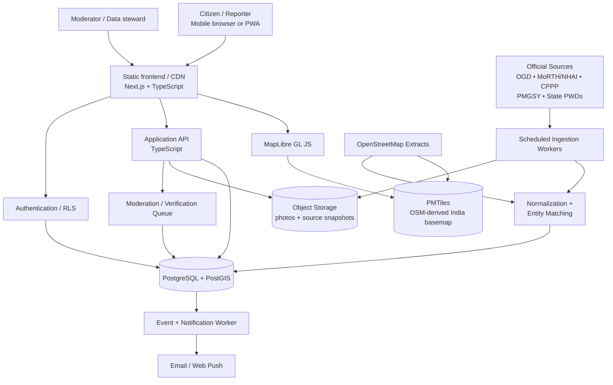
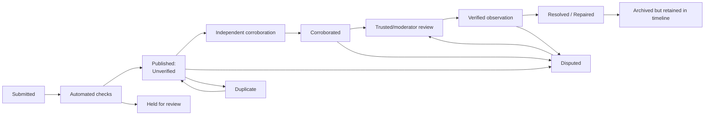
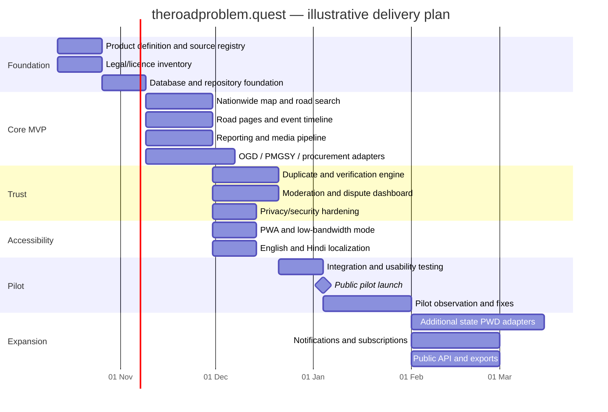

# theroadproblem.quest — A Free-First, Nationwide Platform for Tracking India’s Road Problems

## Executive summary

`theroadproblem.quest` is viable, but the winning product should **borrow the architectural philosophy of God’s Eye View rather than clone its visual experience**.

The official God’s Eye View repository is deliberately built as a hackable geospatial “layer” system: public signals are brought into one interface, individual data sources remain modular, private API credentials are brokered server-side, and source/licensing provenance is documented separately from the MIT-licensed application code. The author explicitly describes the project as a baseline meant to have new layers bolted onto it, while warning that historical geospatial tiling and serving can become expensive. The repository itself also calls the application an exploratory foundation rather than a hardened production service. citeturn19view2turn21view1turn21view3

I could not reliably extract the metadata/content of the exact YouTube URL you supplied, so I have treated the **official God’s Eye View repository, its `DATA_SOURCES.md`, and Bilawal Sidhu's own project write-up** as the authoritative technical references rather than guessing about statements made in the video.

For an Indian road accountability platform, I would make one major departure from God’s Eye View: **do not begin with a photorealistic 3D globe**. God’s Eye View uses CesiumJS and 3D services; its repository notes that some imagery/search capabilities are metered. citeturn21view1 A road-condition service gains much more from a fast, mobile-first 2D vector map that works on weak Indian mobile connections. MapLibre + OpenStreetMap-derived vector tiles + PostgreSQL/PostGIS is the better foundation.

The fundamental product should be:

> **A public, evidence-backed timeline of what is happening to each road segment in India: who owns it, what work is happening, which contractor/package is involved when known, what citizens are observing, when it changed, and how confident the platform is.**

The most important modeling decision is to **never collapse everything into one `status` field**. A road can officially be marked “completed” while citizens observe that it has subsequently been dug up. `theroadproblem.quest` should therefore maintain at least:

**Official state:** tendered → awarded → under construction → completed → maintenance/warranty.

**Observed state:** normal → dug/open → damaged → partially restored → repaired → deteriorated again.

Then the interface can honestly say, for example:

> **Official:** resurfacing work marked completed on 2 September 2026  
> **Community observation:** carriageway excavated again on 9 October 2026  
> **Verification:** 3 independent reports, 2 photos  
> **Contractor:** XYZ Infrastructure Ltd. — sourced from Contract ABC-123

That distinction is what turns the project from a pothole-reporting app into **public infrastructure observability**.

There is no single national, real-time API uncovered in this research that exposes every road, contractor, excavation, repair and current condition. Instead, useful information is fragmented across the Open Government Data platform, MoRTH/NHAI systems, CPPP/eProcurement, PMGSY/OMMAS/GeoSadak, state PWD portals and community mapping. API Setu currently exposes a MoRTH collection centered on vehicle documents such as registration, driving licences, challans and tax receipts rather than a comprehensive road-works API. citeturn16search1turn17search1turn16search9turn18search6 Therefore **a source-adapter/provenance engine is more important than any single API integration**.

A sensible launch strategy is **nationwide geographically, progressive in data depth**. Every part of India can appear on the map from the start using OSM road geometry, while verified official contractor/work data rolls out jurisdiction by jurisdiction. OpenStreetMap data is reusable under ODbL, but OSM’s community tile servers are explicitly not a free production CDN and prohibit bulk/offline downloading. citeturn19view4turn21view4 Therefore the national basemap should ultimately be served from a self-controlled vector-tile archive rather than depending on `tile.openstreetmap.org`.

Official government reuse is surprisingly promising when the source is genuinely open. India’s Government Open Data License permits lawful commercial and non-commercial reuse, adaptation, publication and derivative products with attribution, while excluding things such as personal information and third-party intellectual property. citeturn17search0turn17search2 Conversely, **do not scrape Bhuvan as if everything visible there were open data**: Bhuvan’s published terms prohibit unauthorized bulk feeds, redistribution and derivative use of portal content and describe map/image content as primarily for viewing unless separately permitted. citeturn19view3

The recommended MVP can realistically be delivered in approximately **12–16 weeks by one strong full-stack/GIS engineer plus part-time data/product/moderation help**, or roughly **5–7 months for a solo part-time founder**. The infrastructure can plausibly remain at **₹0–₹2,500/month during a small pilot**, excluding the domain and human labor, by exploiting static hosting, a free Postgres tier and inexpensive object/vector-tile storage. Cloudflare R2 currently includes 10 GB-month of Standard storage, 1 million Class-A operations and 10 million Class-B operations monthly with Internet egress free; AWS's current new-customer Free Tier is temporary—up to $200 of credits and a free account plan for up to six months—so AWS should not be considered a permanent zero-cost strategy. citeturn20search4turn20search1

My recommended long-term shape is:

**Next.js + TypeScript + MapLibre → PostgreSQL/PostGIS → append-only road/event model → OSM-derived PMTiles → source-specific government ingestion adapters → community reporting and verification → transparent provenance for every claim.**

The platform should itself be open source, while **application code and datasets retain separate licenses**, following one of the strongest lessons from God’s Eye View. Its own documentation explicitly warns that bundled/live datasets retain their individual terms even though the code is MIT-licensed. citeturn21view3turn21view4


## Product scope and prioritized feature set

### The core user experience

The home screen should initially be extremely simple:

**Map → tap road/problem → understand what happened → contribute evidence → follow that road.**

Do not overload the first release with analytics dashboards, AI, 3D terrain or routing.

A road or issue detail page should answer:

**Where is it? Who owns the road? What problem exists? When was it first observed? What is the current observed condition? Is there an official work/contract? Who is the contractor? How trustworthy is that information? What happened previously?**

The map itself should distinguish information types visually but also textually so that color is never the only indication:

- road works;
- active road problems;
- restored/repaired problems;
- disputed/unverified reports;
- officially verified projects.

### Prioritized features

| Feature | Priority | MVP? | Implementation |
|---|---:|---:|---|
| Nationwide road basemap | P0 | Yes | OSM-derived vector road network |
| State/district/city search | P0 | Yes | Postgres full-text/trigram + admin boundaries |
| Road/segment detail page | P0 | Yes | Stable shareable URL per road segment |
| Current observed condition | P0 | Yes | Derived from latest validated events |
| Historical road timeline | P0 | Yes | Append-only `events` table |
| User issue report | P0 | Yes | location + category + description + observed time |
| Photo evidence | P0 | Yes | compressed client-side, metadata stripped |
| Road snapping | P0 | Yes | PostGIS nearest-road query |
| Issue map markers/clustering | P0 | Yes | viewport-bounded queries |
| Dug / open / restored / repaired status | P0 | Yes | separate observed-work state machine |
| Official versus community label | P0 | Yes | mandatory provenance classification |
| Contractor/package information | P0 | Yes where available | linked to works/contracts rather than permanently to whole road |
| Source link and retrieval date | P0 | Yes | every imported fact gets provenance |
| Duplicate report detection | P0 | Yes | spatial + temporal candidate matching |
| Corroboration / verification | P0 | Yes | independent confirmations + moderator queue |
| Moderator dashboard | P0 | Yes | evidence, duplicate, abuse and dispute queues |
| Responsive mobile UI | P0 | Yes | design for 360px screen first |
| Low-data mode | P0 | Yes | lighter tiles, no automatic images |
| PWA installation | P0 | Yes | app shell/cache/offline report queue |
| Localization framework | P0 | Yes | English + Hindi initially |
| Open-source repository | P0 | Yes | public code + deployment docs |
| Follow a road/area | P1 | Near-MVP | subscriptions |
| Email digests | P1 | Near-MVP | batched changes, not one mail/report |
| Web Push | P1 | Later | opt-in |
| Fully offline report creation | P1 | Yes after pilot | IndexedDB sync queue |
| More Indian languages | P1 | Yes progressively | volunteer-reviewed catalogs |
| State PWD adapters | P1 | Progressive | source-by-source ETL |
| Tender/contract reconciliation | P1 | Progressive | automated matching + human review |
| Public API | P1 | Later | read-only rate-limited endpoints |
| Bulk open-data export | P1 | Later | only where source licensing permits |
| Reputation system | P1 | Later | evidence quality, not popularity |
| Contractor/authority correction portal | P1 | Later | documented dispute/evidence workflow |
| SMS / WhatsApp notifications | P2 | No | introduces recurring cost and phone-number handling |
| Automated computer-vision pothole detection | P2 | No | collect quality training data first |
| Satellite change detection | P2 | No | high false-positive/compute risk |
| 3D globe | P3 | No | visually attractive, little MVP value |
| AI chatbot | P3 | No | not necessary to establish trust |

**MVP definition:** a user anywhere in India should be able to open a road map, select or search for a road, see existing issues and known official works, submit a geolocated observation, view its verification state and history, and—where official records can be confidently linked—see the work package and contractor.

"Nationwide" should mean **nationwide geographic coverage on launch**, not a promise that every local-body contract in India has already been digitized. The latter would turn an achievable product into an endless data-entry project.

### Model road condition as events, not overwrites

This is the conceptual heart of the product:

```text
Road NH-xx, segment 14.1–14.8 km

12 Jun   official_work_awarded
         contractor = ABC Ltd

03 Jul   excavation_started
         official source

05 Jul   community_observation
         "road dug across one lane"

20 Jul   community_observation
         "still open"

01 Aug   official_work_completed

03 Aug   field_observation
         "surface restored"
         2 independent photos

17 Sep   community_observation
         "surface sinking again"

18 Sep   corroborated
```

Never erase the July problem merely because the road is repaired in August. A core value of the platform is being able to answer **“How many times has this road been dug/repaired?”**

That also enables future measurements such as repair time, recurrence rate, contractor defect history and discrepancies between official completion dates and field observations—without inventing those conclusions prematurely.

### Mobile, multilingual and low-bandwidth design

For low-bandwidth use, cache the application shell, last-used locality data and recently accessed vector tiles; lazy-load media; compress uploads before transmission; provide a map-free list view by district/ward; and allow reports to queue in IndexedDB when connectivity fails. Do **not** build offline use by prefetching standard OpenStreetMap raster tiles: OSM's tile policy explicitly prohibits bulk/offline prefetching on its public tile servers. citeturn19view4

English and Hindi are reasonable launch languages, but the database should never encode UI text directly. Use ICU-format message catalogs through `next-intl` or an equivalent localization framework. Add Bengali, Marathi, Telugu, Tamil, Gujarati, Kannada, Malayalam, Odia, Punjabi, Assamese and other languages according to actual pilot geography and volunteer capacity rather than trying to translate the entire platform at once.

Store citizen descriptions in their **original language**. A later machine-translated rendering can appear beside them, clearly labelled as translated; never destroy the original statement.

Notifications should begin with **email digest + in-app subscription**, followed by Web Push. SMS and WhatsApp are poor first-release choices because they add per-message expenditure, abuse complexity and additional personal-data collection.


## Data model and official-source integration

### Recommended database model

Use PostgreSQL with PostGIS. Supabase's official documentation supports enabling PostGIS and documents indexed point/bounding-box geospatial queries, making it an appropriate free-first managed PostgreSQL option. citeturn20search2

Crucially, distinguish a **logical road** from a **road segment**. “NH 48” can have hundreds of projects and conditions simultaneously; attaching one status or one contractor to the entire road would produce incorrect data.

| Table | Important fields | Purpose / constraints |
|---|---|---|
| `roads` | `id`, `name`, `ref`, `road_class`, `authority_id`, `primary_state`, `source_id` | Logical road identity: NH-48, MG Road, etc. |
| `road_segments` | `id`, `road_id`, `geom MULTILINESTRING`, `chainage_from`, `chainage_to`, `state`, `district`, `local_body`, `osm_ids[]`, `length_m` | Actual spatial unit to which conditions are attached; GiST index on `geom` |
| `contractors` | `id`, `legal_name`, `vendor_identifier`, `cin`, `gstin`, `source_record_id`, `normalized_name` | Organization record; identifiers nullable because they are not always published |
| `works` | `id`, `road_segment_id`, `authority_id`, `tender_id`, `contract_id`, `work_type`, `official_status`, `start_date`, `completion_date`, `contract_value`, `defect_liability_end`, `geom`, `source_record_id` | Government project/package rather than observation |
| `work_contractors` | `work_id`, `contractor_id`, `role`, `source_record_id`, `confidence` | Many-to-many: one project may have multiple organizations and one road many projects |
| `reports` | `id`, `reporter_id`, `road_segment_id`, `work_id?`, `geom POINT`, `category`, `observed_status`, `description`, `observed_at`, `verification_state`, `confidence`, `duplicate_of` | Community observation |
| `report_media` | `id`, `report_id`, `storage_key`, `mime`, `sha256`, `width`, `height`, `privacy_processed_at` | Media kept outside DB |
| `users` | `id`, `display_name`, `email_private`, `role`, `reputation`, `locale`, `created_at`, `deleted_at` | Public identity separated from private contact details |
| `verifications` | `id`, `report_id`, `verifier_id`, `method`, `verdict`, `evidence`, `created_at` | Independent evidence record |
| `events` | `id`, `entity_type`, `entity_id`, `event_type`, `old_state JSONB`, `new_state JSONB`, `observed_at`, `effective_at`, `source_record_id`, `actor_id` | Append-only historical timeline |
| `data_sources` | `id`, `name`, `publisher`, `base_uri`, `license`, `retrieval_method`, `update_frequency`, `terms_reviewed_at` | Registry of each external source |
| `source_records` | `id`, `source_id`, `external_key`, `source_uri`, `retrieved_at`, `checksum`, `raw_object_key`, `parse_version` | Reproducible provenance |
| `subscriptions` | `id`, `user_id`, `road_id?`, `bbox?`, `district?`, `category?`, `channel` | Notification scopes |

Recommended status enums:

```text
official_work_status
planned
tendered
awarded
mobilized
in_progress
officially_completed
maintenance
cancelled
unknown

observed_road_status
normal
dug_open
partially_blocked
damaged
pothole
flooded
unsafe_workzone
temporary_restoration
repaired
deteriorated
unknown

verification_state
unverified
corroborated
moderator_reviewed
officially_verified
disputed
resolved
stale
rejected
```

Do not call a community observation `officially_verified` simply because a moderator approves it. Verification terminology has to tell users **what was actually verified**.

Recommended indexes include:

```sql
GIST (road_segments.geom)
GIST (reports.geom)
GIST (works.geom)

BTREE (reports.verification_state, reports.observed_at DESC)
BTREE (events.entity_type, events.entity_id, events.effective_at DESC)
UNIQUE (source_id, external_key)

GIN (...) -- road/project text search
```

Private account information should live behind row-level security and should not be included in public GIS/API views.

### Source hierarchy

The ingestion engine should prefer sources in this order:

| Tier | Source type | Trust/use |
|---|---|---|
| A | Official machine-readable dataset/API | Primary evidence |
| A | Digitally published official award/work record | Primary evidence |
| B | Official HTML/PDF/tender page | Primary, but requires parsing |
| B | Official open GIS dataset | Primary geometry/evidence |
| C | OpenStreetMap | Basemap / road topology |
| C | Reputable partner/NGO survey | Supplemental |
| D | Trusted field verifier | Field corroboration |
| D | Multiple independent citizen reports | Community corroboration |
| E | Single citizen report | Visible but explicitly unverified |

An attractive UI must never hide those differences.

### MoRTH, OGD and NIC

The Open Government Data Platform should be your first port of call for central-government machine-readable datasets. As of the research date it advertises datasets, web services/APIs and a transport category, and explicitly says its published datasets/resources are owned by the contributing organizations and licensed under the Government Open Data License India. citeturn16search1turn17search5

GODL is particularly useful because it expressly permits lawful adaptation, value addition and derivative products for commercial or non-commercial purposes, provided attribution and other license conditions are respected. It excludes personal information, sensitive/non-shareable data and third-party IP. citeturn17search0turn17search2

Create an OGD adapter that accepts:

```text
catalog/resource ID
dataset version
published/update date
source agency
license
CSV/JSON/API URL
retrieved_at
checksum
```

Never assume that a dataset remains current merely because it remains accessible. OGD's own terms tell users to verify updated information with the concerned government department. citeturn17search3

### CPPP/eProcurement and contractor extraction

The central eProcurement portal is extremely valuable for turning road projects into structured work records. A current NHIDCL tender page, for example, publicly exposes fields including organization chain, tender reference and ID, contract form, work description, tender value, location, work duration, published/opening dates and downloadable tender documentation. citeturn16search9

Your importer should normalize:

```text
Tender ID
Tender reference
Agency
Road reference
Package/project name
State/district/location
Chainage start/end
Work type
Tender amount
Award/contract amount
Tender dates
Award date
Contractor name
Completion period
Source URL
```

Tender publication is **not** proof that a bidder won. Only populate `work_contractors` once an award/LoA/contract record supports the linkage.

The hard problem will be geospatial reconciliation. Government procurement records often identify works by road reference, chainage, package and place names rather than an OSM segment ID. I therefore recommend a confidence-scored matcher:

```text
package/tender ID exact match               strongest
NH/SH road reference match
chainage overlap
district/state match
project/title similarity
named endpoints match
time-window match
manual review                            required when ambiguous
```

Never display an algorithmically guessed contractor as “the contractor.” Show:

> Possible match — awaiting verification

until a source record or reviewer resolves it.

### NHAI

NHAI/MoRTH's Data Lake ecosystem clearly contains detailed project-oriented fields: a public NHAI/MoRTH claims form exposes company, project name, chainage, NH number, road length, project type, award date, agreement date, completion date, type of work and contract amount. citeturn16search2 That proves the underlying ecosystem contains many of the concepts `theroadproblem.quest` needs.

It does **not** mean the Data Lake should be treated as a public bulk API.

Where information is openly browsable, consume only what terms permit. Where login, OTP or CAPTCHA exists, **do not automate around those controls**. Instead request an official API/export or find the corresponding procurement/open-data record.

### PMGSY, OMMAS and GeoSadak

This may be one of the strongest official integrations for rural India.

The National Rural Infrastructure Development Agency states that information and details about every PMGSY work are available through OMMAS, which is used to manage and monitor programme data entered by field/state units. citeturn18search6 The government also announced that PMGSY GIS data had been released into the public domain through GeoSadak; the release describes rural-road data and broader supporting national geospatial layers. citeturn18search1

NRIDA itself lists OMMAS, GeoSadak, GRRIS and GePNIC/PMGSY tendering among its major online services. citeturn18search4

Build a dedicated PMGSY adapter early, because it could provide a comparatively structured end-to-end example of:

```text
road
sanction/work
tender/package
construction state
quality/inspection information
maintenance
GIS geometry
```

PMGSY also explicitly incorporates five years of routine maintenance into construction tendering before subsequent maintenance arrangements, which is useful for building responsibility/warranty concepts into the data model. citeturn18search6

### API Setu / NIC APIs

Treat API Setu as **a discovery and partnership channel, not as the database**.

API Setu describes itself as MeitY's Open API platform for discovering, subscribing to and consuming APIs. citeturn17search4turn17search9 However, the current MoRTH collection found during this research exposes vehicle-tax, challan, registration, driving-licence, insurance and fitness-document capabilities rather than a nationwide road works/contractors API. citeturn17search1

Therefore implement the integration interface now:

```ts
interface GovernmentSourceAdapter {
  discover(): Promise<SourceItem[]>
  fetch(item: SourceItem): Promise<RawRecord>
  parse(raw: RawRecord): Promise<NormalizedRecord[]>
  validate(records: NormalizedRecord[]): Promise<ValidationResult>
}
```

Then an API Setu road API can be added later without changing the rest of the platform.

### OpenStreetMap

OSM should provide **road geometry/topology and basemap information**, not your truth about whether a road is currently dug.

The God’s Eye View project itself uses OSM data under ODbL and maintains explicit OSM attribution/license separation. citeturn21view4

Do not point a popular national site indefinitely at OSM's public raster servers. OSMF says the data is free but its tile servers have limited community-funded capacity, can block heavy use, require attribution/caching, and prohibit bulk/offline prefetching. citeturn19view4

Recommended pattern:

```text
OSM extract
   ↓
vector-tile generation
   ↓
India.pmtiles
   ↓
your object storage/CDN
   ↓
MapLibre
```

This gives control over caching, low-data styles and offline behavior while preserving OSM attribution.

### Bhuvan

Bhuvan is extremely useful as an **official Indian geospatial reference**. The Bhuvan portal exposes 2D/3D visualization, open-data areas and OGC/thematic services. citeturn19view3

But treat each Bhuvan resource's license separately. The portal's general terms say, absent written authorization, users must not use means other than those provided by Bhuvan to access content, make derivatives, redistribute it or perform mass downloads/bulk feeds; its terms also say map/image content may be provided for viewing purposes only. citeturn19view3

So:

**Good:** use Bhuvan manually to validate geometry, discover official programs, and integrate a particular OGC/open dataset after confirming its license.

**Bad:** crawl the Bhuvan map and republish tiles/coordinates nationwide.

Ask NRSC for explicit permission or a licensed service if you find a Bhuvan layer crucial to the project.

### State PWDs and fallback scraping

State PWD integration should be plugin-based because a single national scraper will become unmaintainable.

Every adapter should declare:

```yaml
source:
  agency: "..."
  jurisdiction: "..."
  method: api | csv | html | pdf | manual
  licence: "..."
  terms_reviewed: "..."
  refresh: daily | weekly | monthly
  rate_limit: "..."
  robots_checked: true
```

Use this fallback order:

**API/CSV/GeoJSON → official downloadable spreadsheet → stable HTML page → official PDF extraction → human data entry.**

For web scraping, use conditional requests, cache aggressively, identify your crawler, throttle requests and preserve the source URI and retrieval timestamp. Never bypass CAPTCHA, login, OTP, rate limits or access restrictions. When an important dataset is trapped in PDFs, contact the department/OGD portal and request a machine-readable publication rather than building an increasingly brittle OCR pipeline.

Every fetched record should be checksummed before normalization. If the source later changes, generate an event rather than silently overwriting history:

```text
source_record fetched
        ↓
checksum changed?
        ↓ yes
parse
        ↓
normalize
        ↓
entity matching
        ↓
confidence
    ↙          ↘
high            ambiguous
 ↓                 ↓
publish event    review queue
```


## Architecture and recommended technology stack

### Recommended architecture



### Recommended stack

| Layer | Primary recommendation | Why | Alternative |
|---|---|---|---|
| Language | TypeScript end-to-end | Shared schemas/types, contributor-friendly | Go for ingest later |
| Frontend | Next.js | SSR/shareable road pages + PWA ecosystem | React/Vite |
| UI | Tailwind + accessible component library | Fast mobile UI development | CSS modules |
| Map | MapLibre GL JS | Open vector-map stack | Leaflet for simpler MVP |
| Basemap | OSM-derived PMTiles | CDN-friendly, self-controlled | hosted OSM-vector vendor |
| DB | PostgreSQL + PostGIS | Roads/points/lines/spatial joins | none recommended |
| Managed DB MVP | Supabase/Postgres | PostGIS + auth/RLS | Railway Postgres |
| API | TypeScript API/Edge functions | Minimal operational footprint | Fastify container |
| Search | PostgreSQL FTS + trigram | Avoid paying for separate search | Meilisearch later |
| Auth | Magic-link/OAuth + optional guest reporting | Lower password risk | self-hosted auth |
| Media | Cloudflare R2 | low-cost object storage | S3 |
| Background jobs | small worker / scheduled function | government ingestion | Railway/VPS |
| Notifications | email digest + Web Push | cheapest channels | SMS later |
| Analytics | privacy-respecting aggregate analytics | minimize user tracking | self-host later |
| Deployment | Netlify/static CDN + managed DB | very low MVP ops | Cloudflare / VPS |
| Later single-server | Hetzner/DigitalOcean Docker VM | predictable paid cost | AWS |
| CI/CD | GitHub repository | natural open-source workflow | equivalent Git forge |

PostGIS is especially appropriate because nearest-road snapping, bounding-box loading and indexed spatial queries are first-class operations; Supabase's official PostGIS documentation demonstrates both indexed geographic types and map viewport/bounding-box queries. citeturn20search2

### Why MapLibre rather than Cesium

God’s Eye View is intentionally immersive: its current implementation is vanilla JavaScript + CesiumJS + Vite, with optional Google photorealistic 3D and other provider integrations. citeturn21view1

For `theroadproblem.quest`, 3D creates:

- more transferred data;
- more GPU usage on cheap phones;
- harder offline support;
- additional vendor/API exposure;
- more complicated interaction on small screens;
- almost no improvement in distinguishing “road dug yesterday” from “road repaired today.”

Use that engineering effort on **provenance, contractor matching and verification**, which are the hard parts competitors will struggle to reproduce.

An optional 3D mode can come much later for bridges, elevated corridors or construction visualization.

### PMTiles and cheap map delivery

PMTiles is a particularly strong fit because a large vector-tile collection can be represented as an archive served through HTTP range requests instead of operating a traditional tile server.

The Protomaps documentation provides a Cloudflare R2/Workers deployment model for PMTiles. It notes that R2's storage/egress economics can be attractive, while warning that latency may be higher than other cloud storage and should be benchmarked. citeturn20search3

Cloudflare currently documents a monthly R2 free allowance of 10 GB-month Standard storage, one million Class-A operations, ten million Class-B operations and free Internet egress. citeturn20search4

That makes the rough free-first pattern:

```text
theroadproblem.quest
       │
       ├─ HTML/JS/CSS ───── static CDN
       │
       ├─ India basemap ─── PMTiles / R2
       │
       ├─ issue queries ─── PostGIS
       │
       └─ report photos ─── R2
```

A nationwide detailed basemap may eventually exceed the free storage allowance depending on how it is generated; **do not design around an assumption that “all of India must fit in 10 GB.”** Make map storage replaceable.

### Lessons to copy from God’s Eye View

The repo offers several concrete design lessons.

**Copy its modular sources.** God’s Eye View separates layer/data modules and explicitly encourages contributors to bolt on new sources. citeturn19view2turn21view1 Your equivalent should be `adapters/morth`, `adapters/pmgsy`, `adapters/cppp`, `adapters/<state-pwd>`.

**Copy its licensing discipline.** Its source code is MIT but datasets retain their own licenses. citeturn21view3turn21view4 Do the same.

**Copy its key isolation.** The repo proxies APIs involving private credentials through server-side handlers rather than exposing those secrets to the browser. citeturn21view1

**Copy its honest uncertainty.** The repository explicitly warns that public data can be incomplete, delayed or incorrect and that important decisions should be verified against authoritative sources. citeturn21view3 `theroadproblem.quest` needs an even stronger equivalent because contractor and public-works claims can affect reputations.

**Do not copy its production assumptions wholesale.** The repository itself says it is a fast, hackable exploration/learning foundation rather than a hardened production service. citeturn21view3 You need accounts, row-level security, rate limiting, moderation, audit history, backups and privacy handling from the start.

**Do not depend on public community APIs for bulk workloads.** God’s Eye View itself rate-limits its public OSRM usage and states that heavy automated routing should operate its own infrastructure. citeturn21view4 The same principle applies to OSM tile/Overpass infrastructure.

### Recommended API

Keep v1 deliberately small:

```text
GET  /api/v1/map/issues?bbox=
GET  /api/v1/roads/:id
GET  /api/v1/roads/:id/events
GET  /api/v1/roads/:id/works
GET  /api/v1/works/:id
GET  /api/v1/contractors/:id
GET  /api/v1/reports/:id

POST /api/v1/reports
POST /api/v1/reports/:id/corroborate
POST /api/v1/subscriptions

POST /api/v1/mod/reports/:id/review
POST /api/v1/mod/entities/:id/dispute
```

Map endpoints should always take a viewport/bounding box and enforce server-side limits. Never send every report in India to the browser.

### Hosting choices

| Provider | Best role | Free-first assessment |
|---|---|---|
| Netlify | frontend/PWA | Strong candidate for MVP |
| Vercel | Next.js frontend | Technically excellent but check usage classification |
| Supabase | Postgres/PostGIS/auth | Strong MVP option |
| Cloudflare R2 | media + PMTiles | Excellent cost structure for static geospatial objects |
| Railway | API/worker/DB | Very simple when you are ready to pay a few dollars |
| AWS | mature production stack | Good credits for new account, not permanent free hosting |
| Hetzner | later VPS | Good simplicity/cost when managed free tiers become limiting |
| DigitalOcean | later VPS/managed DB | straightforward paid alternative |

One important Vercel caveat: the researched Vercel Hobby offering is positioned for personal/non-commercial use, so do not assume it remains suitable if `theroadproblem.quest` becomes an NGO, commercial service or paid-API business. citeturn14view0turn14view1

Netlify currently offers a no-cost tier with a monthly credit allowance and CDN/deployment capabilities. citeturn14view2turn14view3 Railway's paid Hobby tier has a low monthly usage floor, making it a convenient migration destination for ingestion workers when permanently free compute becomes inconvenient. citeturn13view1

AWS's current Free Tier is better understood as startup credits than permanent hosting: new users can receive up to $200 in credits and use a free account plan for a maximum of six months before needing to change plans or lose the running environment. citeturn20search1

### Operational controls from day one

Create these before public launch:

```text
database migrations
daily backup/export
separate production/staging DB
admin MFA
signed media upload URLs
upload MIME/size validation
application rate limiting
CSP/security headers
structured logs
error reporting
budget alerts
automated dependency updates
per-source ingestion health
last-success timestamp for every adapter
source checksum history
moderator audit log
```

For photos, cap the initial system to perhaps two images/report, resize client-side to a useful inspection resolution and compress aggressively. Keeping arbitrary original 20-megapixel phone photos will destroy the “free-to-run” objective much faster than database rows will.


## Verification, moderation, privacy and legal design

### Verification is the product

A road-reporting platform that does not distinguish evidence quality will eventually become a map of accusations.

Use a lifecycle such as:



A report should normally become visible quickly as **Unverified**, unless automation detects privacy, abuse or obvious spam problems. Holding every submission for moderators creates an impossible nationwide bottleneck.

### Evidence model

| Evidence | Result |
|---|---|
| One anonymous/user report | Unverified |
| Additional independent report nearby | Increases confidence |
| Independent fresh photo | Stronger corroboration |
| Trusted local verifier | Field-corroborated |
| Moderator checks evidence | Evidence-reviewed, not automatically “official” |
| Government project/inspection/status record | Official-source verified |
| Government record conflicts with recent field reports | Show both; do not erase either |
| Contractor/agency submits documentary correction | Dispute/review workflow |

Avoid “likes” or majority voting as truth.

A useful confidence model could internally assign weights, but show ordinary users interpretable labels rather than `0.736`.

For example:

```text
UNVERIFIED
One citizen observation

CORROBORATED
Three independent observations within this area

FIELD REVIEWED
Evidence reviewed by a trusted verifier

OFFICIAL SOURCE
Status sourced from NHAI/PMGSY/PWD record

DISPUTED
Conflicting evidence is currently under review
```

### Duplicate detection

When a report arrives:

1. Snap the location to the nearest plausible road segment.
2. Search existing unresolved reports within a small spatial radius.
3. Filter by compatible category and recent observation window.
4. Ask the reporter: **“Is this the same problem?”**
5. Attach corroboration/evidence to the existing incident if appropriate.

This avoids ten pothole markers representing one pothole.

Do not automatically merge merely because two points are close. Urban intersections, service lanes, flyovers and parallel carriageways create legitimate spatial ambiguity.

### Contractor and government claims

This portion needs unusually careful language.

Do not publish:

> ABC Construction damaged this road.

unless a reliable source establishes responsibility.

Publish:

> ABC Construction is listed as contractor for Work Package XYZ.  
> A community report observed damaged pavement within the project's mapped area.

Those are distinct claims.

Each contractor card should provide:

```text
Legal/normalized company name
Role in project
Tender / contract / package
Awarding authority
Source
Source publication/retrieval date
Match confidence
Related road segment(s)
Known official project status

[Report incorrect linkage]
```

Do not create public “worst contractor” rankings in the MVP. Once data quality has matured, metrics can be calculated objectively, but early rankings based on uneven reporting density are a recipe for both misleading conclusions and disputes.

### Privacy engineering

India's Digital Personal Data Protection Act, 2023 is the primary modern statutory framework for digital personal data; the official India Code entry confirms the Act, and MeitY published the final Digital Personal Data Protection Rules, 2025 on November 14, 2025 along with an enforcement timeline. citeturn16search0turn22search2

Build for the full compliance posture now rather than waiting until every phased provision is applicable.

Recommended privacy defaults are:

| Data | Public? | Recommendation |
|---|---|---|
| Display name | optional | pseudonym allowed |
| Email | No | encrypted/private account field |
| Phone | Avoid collecting | unnecessary for MVP |
| Report road location | Yes | necessary to service |
| Reporter live location history | No | never collect |
| Photo | Yes after processing | strip metadata / review |
| Raw EXIF GPS | No | remove after location extraction |
| Face/number plate | Prefer no | automatically blur + moderator review |
| IP address | No | retain only as briefly as necessary for security |
| Notification preferences | No | private |
| Reporter reputation | limited | avoid exposing detailed behavioral profile |

A report should require the location **of the infrastructure problem**, not permission to continuously track the user's device.

The public profile does not need the citizen's real identity.

Provide a privacy notice that clearly explains why location/photo/account data is collected, retention periods, contact/grievance channels, deletion procedures and what gets published. Seek Indian privacy counsel before public launch; this report is a product/engineering plan, not a substitute for legal advice.

### User-generated content and intermediary risk

The service will host citizen-generated descriptions and photographs, so your terms and moderation system should also be designed around India's IT framework. The Information Technology Act, 2000 remains on India Code, while MeitY continues to maintain the Information Technology (Intermediary Guidelines and Digital Media Ethics Code) Rules, 2021. MeitY was also publishing draft amendment materials during 2026, showing that the regulatory environment remains active and needs to be rechecked before launch. citeturn22search7turn22search1turn22search0

Operationally, that means having at least:

```text
published Terms of Use
published Privacy Notice
content/reporting mechanism
grievance/contact address
documented moderation process
legal request workflow
appeal/correction workflow
audit log
response process for unlawful content notices
```

Do not write a legal policy once and forget it; review it before national launch and after material regulatory changes.

### Media safety and privacy pipeline

Recommended flow:

```text
photo selected
    ↓
resize/compress locally
    ↓
strip EXIF
    ↓
calculate content hash
    ↓
upload with signed URL
    ↓
malware/file validation
    ↓
face / number-plate privacy processing
    ↓
moderator review when needed
    ↓
publish processed version
```

Keep the original only when genuinely necessary for evidentiary review and define a shorter retention period for it.

### Data licensing

The licensing strategy should be deliberately layered.

**Application code:** I recommend MIT or Apache-2.0. MIT matches the God’s Eye View precedent and maximizes adoption; its repository is expressly MIT-licensed. citeturn21view3

**OpenStreetMap-derived road data:** retain ODbL obligations and required attribution. God's Eye View's own data-source documentation similarly identifies OSM-derived datasets separately under ODbL. citeturn21view4

**OGD government records:** preserve GODL attribution/provider/source/license metadata. GODL requires attribution and supports a separate attribution page when multiple datasets are used. citeturn17search0turn17search2

**Bhuvan:** do not redistribute unless that specific dataset/service permits it or written permission is obtained. General Bhuvan terms are substantially more restrictive than GODL. citeturn19view3

**Citizen photos:** contributor terms need to state precisely what licence the contributor grants the platform. Do not automatically declare users' photographs open data without explicit terms/consent.

**Community-created issue data:** select an open-data licence after checking compatibility with ODbL/GODL and your export architecture.

The safest engineering approach is to preserve a source/license field all the way through the data pipeline rather than creating one giant database and declaring the entire thing “open.”

An `/attributions` page can be automatically generated from `data_sources`.

This mirrors an important lesson from God’s Eye View: the application source licence does not magically override third-party dataset restrictions. citeturn21view3turn21view4


## Costs, operations and community sustainability

### Infrastructure cost model

A genuinely **₹0/month prototype** is realistic. A popular nationwide production service permanently costing ₹0 is not.

The expensive variables will eventually be:

```text
map requests
photo/media storage
database compute
data-ingestion compute
email/SMS/WhatsApp volume
backups
moderation labor
```

—not hosting the JavaScript application.

Cloudflare's present R2 allowance makes object storage especially attractive for the first stage: 10 GB-month of Standard storage and substantial request allowances with Internet egress free. citeturn20search4

God’s Eye View's creator arrived at the same broader economic lesson from a different application: a useful live baseline can lean heavily on free/public services, but historical geospatial tiling and serving are where compute/data cost escalates. citeturn19view2

### Planning budget

These are **engineering-budget estimates rather than quoted vendor prices**, because usage and provider limits will change.

| Phase | Expected traffic | Infrastructure planning range | Main spend |
|---|---|---:|---|
| Local development | developers only | ₹0/mo | local Docker |
| Closed prototype | tens of users | ₹0/mo | free tiers |
| Public MVP | hundreds–low thousands MAU | ₹0–₹2,500/mo | domain, worker/email if needed |
| City/state pilots | thousands–tens thousands MAU | ₹2,500–₹10,000/mo | DB, worker, storage |
| Multi-state | tens/hundreds thousands | ₹5,000–₹25,000/mo | DB/compute/media |
| National moderate adoption | substantial public usage | ₹10,000–₹50,000+/mo | DB replicas/compute/CDN/media/ops |
| Very large national platform | high traffic/report volume | usage-dependent | dedicated infra + operations |

The first two rows are achievable only if you aggressively control media, avoid paid geocoding and do not generate expensive imagery.

Current provider facts put those ranges in context: R2 provides a meaningful zero-cost storage/request allowance; Railway offers a low-minimum paid path when a persistent worker becomes necessary; AWS's current free account is capped in duration rather than permanent. citeturn20search4turn13view1turn20search1

### Free-first configuration

A realistic first deployment could be:

| Service | Initial choice | Target bill |
|---|---|---:|
| Frontend | Netlify Free/static hosting | ₹0 |
| PostgreSQL/PostGIS | managed free tier | ₹0 |
| Auth | bundled with managed DB | ₹0 |
| Photos | R2 | ₹0 within allowance |
| Basemap | PMTiles/R2 | ₹0 within allowance |
| API | managed edge/functions | ₹0 within allowance |
| Ingestion | scheduled lightweight worker | ₹0 initially |
| Email | free transactional quota | ₹0 initially |
| Monitoring | free tier | ₹0 |
| Domain | registrar-dependent | annual cost |

Netlify currently advertises a free tier with CDN/deployment functionality and a monthly credit allowance. citeturn14view2turn14view3

When you outgrow the free setup, **do not immediately create a microservices architecture**. A small VPS running:

```text
API
worker
PostgreSQL/PostGIS
reverse proxy
```

can be dramatically simpler to operate than seven cloud products. Hetzner or DigitalOcean become reasonable candidates at that stage, while Railway provides the easiest managed transition.

### Labor cost

Infrastructure is likely to be a tiny fraction of MVP cost if contributors are paid.

A reasonable MVP resource assumption is approximately:

```text
Full-stack/GIS engineering       14 weeks × 1.0 FTE
Data/integration engineering     14 weeks × 0.3–0.5 FTE
Product/UI                       14 weeks × 0.2 FTE
Moderation/community design      14 weeks × 0.2 FTE
Privacy/legal review             targeted external review
```

That equates to roughly **730–840 technical/product hours** depending on overlap.

For budgeting only, if paid contributors average approximately ₹600–₹1,500/hour, the engineering/product portion would be roughly **₹4.5 lakh–₹12.5 lakh**, before legal review and contingency. A safer planning envelope is therefore approximately **₹5–₹15 lakh for a professionally paid lean MVP**.

That is not a market quote. With you plus open-source volunteers, the cash labor bill can approach zero; the underlying amount of human work does not.

### Community operating model

The platform should not rely on random crowdsourcing alone.

Create four community roles:

| Role | Function |
|---|---|
| Reporter | submits observations |
| Local verifier | revisits/validates reports |
| Data steward | maintains a state/source adapter |
| Moderator | handles abuse, disputes and ambiguous evidence |

Then build geographic communities around **“adopt a ward / adopt a road”**, rather than competing for a national leaderboard.

Good recruitment pools include civic-tech volunteers, mapping communities, civil-engineering students, urban-planning students, local resident groups, road-safety organizations and NGOs.

The first community campaign should be concrete:

> **Map every unresolved road excavation in one district for 30 days.**

That produces measurable outcomes and moderator experience. “Map every broken road in India” does not.

### Open-source contribution workflow

Repository structure could be:

```text
/apps
  /web
  /worker

/packages
  /database
  /geo
  /ui
  /verification
  /i18n

/adapters
  /data-gov-in
  /cppp
  /pmgsy
  /nhai
  /state-template

/data
  /schemas
  /source-registry

/docs
  architecture.md
  data-model.md
  verification-policy.md
  moderation-policy.md
  privacy-design.md
  adding-a-source.md
  attribution.md
```

Require every source PR to provide:

```text
publisher
official URL
retrieval method
licence
sample fixture
parser tests
update frequency
expected identifiers
known limitations
```

This creates a scalable path where a contributor in Kerala can add a Kerala source without needing to understand the entire national application.

### Sustainability without charging citizens

Keep citizen access and reporting free.

Good later revenue models are:

**Grants/CSR/philanthropy:** particularly compatible with public-infrastructure transparency.

**Donations:** recurring community support.

**Paid institutional API:** companies/researchers pay for higher rate limits while citizens retain free map access.

**Hosted dashboards:** NGOs, newsrooms, municipalities or infrastructure organizations pay for private workflows/SLA.

**Data-quality/analytics services:** organizations pay for aggregates and tooling, subject to source licences and privacy constraints.

**Implementation/consulting:** deploy the open-source platform for specific organizations.

Avoid business models where:

- contractors pay to suppress reports;
- authorities pay for preferential verification;
- advertisers can influence rankings;
- citizens must pay to see evidence;
- user location histories are monetized.

A simple project governance promise could be:

> **Public road observations remain publicly accessible. Payment can buy tooling, capacity or service guarantees—not the ability to rewrite facts.**


## Implementation roadmap, milestones and resourcing

### Recommended delivery sequence

The most important project-management decision is to **prove one complete information loop before adding dozens of data sources**:

```text
OSM road
  ↓
citizen report
  ↓
road snap
  ↓
map marker
  ↓
corroboration
  ↓
timeline
  ↓
repair observation
  ↓
resolved
```

Then prove one complete government loop:

```text
official tender
  ↓
normalized work
  ↓
contractor
  ↓
road/chainage matching
  ↓
human confirmation
  ↓
road page
  ↓
official status update
```

Once both loops work, scale geography.

### Illustrative timeline

This schedule assumes work begins Monday, October 12, 2026. Dates are illustrative; the dependencies matter more than the exact launch date.



### Phase-by-phase deliverables

| Stage | Time | Milestone | Staffing |
|---|---:|---|---|
| Discovery | Weeks 1–2 | source/licence registry, product spec, wireframes | founder + engineer + legal consultation |
| Foundation | Weeks 3–4 | PostGIS schema, auth, CI/CD, OSM road ingest | 1 engineer |
| Reporting | Weeks 5–7 | map, search, road pages, user reports, photos | 1 engineer + part-time design |
| Official data | Weeks 6–9 | OGD + one procurement + PMGSY adapter | engineer/data contributor |
| Trust layer | Weeks 8–11 | moderation, duplicate detection, provenance, verification | engineer + moderator |
| Inclusion | Weeks 10–12 | PWA, low-bandwidth, English/Hindi | engineer + translators |
| Hardening | Weeks 12–14 | security, privacy, backup/recovery, accessibility | engineer + reviewers |
| Pilot | Weeks 15–18 | real community usage and bug/data correction | core team + local volunteers |
| Multi-state | Following 6–12 weeks | several PWD adapters, alerts, API | growing contributor network |
| National maturity | 6–12 months | deeper contractor/work coverage across jurisdictions | dedicated data/community capacity |

### Acceptance criteria for the MVP

Do not call the MVP finished until all of these work together:

| Test | Required outcome |
|---|---|
| Any Indian locality can be opened | Yes |
| User can identify/select a road | Yes |
| Report works on an inexpensive Android phone | Yes |
| Weak connection does not break the app | Yes |
| Offline report can be retained locally | Yes |
| Report location attaches to a road segment | Yes |
| Report displays source/time/verification state | Yes |
| Duplicate report can become corroboration | Yes |
| Moderator can merge/reject/dispute | Yes |
| Road timeline preserves old states | Yes |
| One official data source updates automatically | Yes |
| One contractor can be tied to a documented work package | Yes |
| Every official fact links to provenance | Yes |
| English/Hindi UI works | Yes |
| OSM/government attribution is visible | Yes |
| Private account information is absent from public APIs | Yes |
| Database can be restored from backup | Yes |

### What to build first

For the first coding sprint, I would implement the system in this order:

**Database first.** Establish `roads`, `road_segments`, `works`, `contractors`, `reports`, `events`, `source_records`.

**OSM second.** Load one pilot geography, perform spatial road snapping, then expand the same pipeline nationally.

**Map third.** Build MapLibre viewport queries and clustering.

**Reporting fourth.** Add observations and evidence.

**Timeline fifth.** Make every meaningful change create an event.

**Provenance sixth.** Import a single official source end to end.

**Moderation seventh.**

Only after those are reliable should development branch into more jurisdictions, notifications and languages.

### The first pilot I would actually run

Even though the map should technically cover India, choose **one dense urban area plus one PMGSY-heavy rural district** as operational pilots.

The urban pilot tests:

```text
potholes
utility excavation
multiple authorities
frequent repeat digging
street-name ambiguity
high report density
```

The rural pilot tests:

```text
long road segments
poor connectivity
offline reporting
PMGSY integration
contract/work records
low address density
```

This combination will expose much more of the product's real problems than launching in five metro cities at once.

### Success metrics

Do not optimize initial success around registrations or map views.

Track:

| Metric | Why it matters |
|---|---|
| % reports snapped to correct road | foundational data quality |
| % reports with sufficient evidence | trust |
| duplicate detection accuracy | map cleanliness |
| median report → corroboration time | community effectiveness |
| median issue → observed repair time | civic usefulness |
| % official facts with valid provenance | auditability |
| % known works linked to road geometry | integration effectiveness |
| % known works with contractor link | accountability objective |
| dispute/correction turnaround time | fairness |
| stale-report rate | maintenance quality |
| mobile page weight/load time | Indian accessibility |
| data-source ingestion failures | operational reliability |

Do **not** use “number of complaints” as a road-quality ranking without normalizing for exposure/reporting density. A heavily used road in Bengaluru will naturally receive more reports than an equally bad road with 1/100th of the user base.

### Long-term technical path

Once the MVP proves demand:

```text
MVP
│
├── More state adapters
├── Stronger entity matching
├── Web Push
├── Open API
├── Data exports
├── Public statistics
│
└── Scale threshold
     │
     ├── dedicated ingest workers
     ├── read replicas / caching
     ├── dynamic vector tiles for reports
     ├── richer search
     ├── organization accounts
     └── automated anomaly detection
```

Only after a substantial corpus of labeled road problems exists should you investigate computer vision. At that point your own verified before/after photographs could become a far more valuable dataset than plugging a generic pothole model into the MVP.

### Recommended launch architecture in one sentence

**Build `theroadproblem.quest` as a mobile-first, open-source MapLibre PWA backed by PostgreSQL/PostGIS, using self-controlled OSM-derived PMTiles for nationwide roads, event-sourced community observations for current condition, independently sourced government work/contract records for accountability, and a provenance/verification system that makes the distinction between “official,” “observed,” “corroborated,” and “unknown” impossible to miss.**

### Key limitations and unresolved items

The largest unresolved issue is **data completeness, not software**. The research found excellent individual components—open government datasets under GODL, CPPP tender records, PMGSY/OMMAS/GeoSadak, NHAI systems, OSM geometry and Bhuvan reference layers—but no single national machine-readable source covering every municipal/state/national road project and contractor. citeturn17search2turn16search9turn18search1turn18search6turn17search1 The platform therefore has to make incompleteness visible rather than pretending it has information that government sources do not expose.

Bhuvan integration must be handled cautiously because its general terms restrict automated/bulk extraction and redistribution unless separately authorized. citeturn19view3

The supplied YouTube URL could not be reliably inspected directly, so conclusions about the inspiration are based on the official God’s Eye View GitHub repository and Bilawal Sidhu's own published description. Those sources are nevertheless sufficient to establish the project's technical approach: modular open/public-data layers, server-side credential handling, explicit source licences, low-cost baseline operation, and a deliberately extensible open-source foundation. citeturn19view2turn21view1turn21view3turn21view4

Finally, infrastructure can be nearly free at launch, but **“free-to-run” should be treated as an MVP constraint rather than a permanent architectural promise**. Cloud storage, free-tier compute and static deployment can support early adoption, but nationwide success eventually creates legitimate costs in database capacity, media, ingest processing and—most importantly—human moderation/data stewardship. R2's current free allowances and the availability of low-cost hosting make that transition gradual rather than immediately expensive. citeturn20search4turn13view1

The strongest version of `theroadproblem.quest` is therefore not “Google Maps with pothole pins.” It is an **open, auditable ledger of road condition and public works for India**, where every state change has a date, every official claim has a source, every citizen observation has a verification state, and every road can accumulate a transparent history instead of having yesterday's problem disappear when somebody changes a database field.