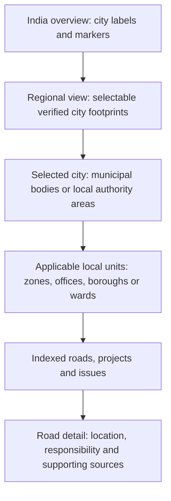
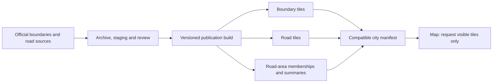

# City selection and jurisdiction navigation: proposed design

Prepared 16 October 2026. This is a design and rollout plan for review; no application, database or deployment changes are included. Antigravity's road-tile and caching work remains the foundation for road rendering.

## 1. Intended result

When someone zooms out, the map becomes a way to choose a city. At national scale they see city names and selectable markers. Closer in, verified city footprints become selectable shaded areas. Selecting Bengaluru, Mumbai, Delhi or another city opens that area and reveals its own applicable administrative divisions. At street scale, indexed roads, projects and reported issues appear.

The city catalogue starts with **36 major city areas**, listed in [CITY_INVENTORY.md](CITY_INVENTORY.md). This is an explicit first research/onboarding scope, not a claim to enumerate every major Indian city or to have indexed those 36 cities. Additional cities use the same onboarding process and national identifiers.

Success means someone can find the right city, understand which local unit a road is in, and see who is responsible when there is supporting evidence. It also means the app clearly distinguishes missing data from zero spending, zero roads or zero issues.

## 2. Recommended approach and alternatives

| Approach | Benefit | Limitation | Decision |
|---|---|---|---|
| City markers and manually drawn approximate shapes | Quick discovery UI | Cannot support reliable ward attribution or agency accountability | Use markers while authoritative boundaries are pending; do not call approximate shapes official |
| One universal state → district → city → zone → ward tree | Simple initial implementation | Does not fit metropolitan areas, development authorities, multi-corporation cities or overlapping departments | Reject as the canonical model |
| City catalogue plus separate, versioned jurisdiction schemes | Fits local government differences and supports historical contracts | Requires a source registry, geometry review and explicit relationships | **Recommended** |

The displayed drilldown can look like a tree. The stored relationships must accommodate overlapping areas and different boundary schemes.

## 3. The geographic layers we need

| Layer | What it means | What it must not imply |
|---|---|---|
| City discovery region | A familiar place users can select; sometimes a collection of municipal bodies | A new government body or a road owner |
| Municipal body / development authority | The actual public organization and its notified jurisdiction | Ownership of every road inside it |
| Administrative area | Zone, circle, borough, regional office or other service unit | An electoral ward or engineering division unless specifically documented |
| Electoral area | Ward, division or prabhag under a particular delimitation | A maintenance jurisdiction; a prabhag can elect several councillors |
| Revenue geography | State, district, tehsil, village and other land-administration units | The same boundary as the city |
| Planning geography | Metropolitan region, master-plan zone, development node or sector | Municipal government or present road custody |
| Engineering / asset geography | Road division, work circle or maintenance package | A clean partition that necessarily follows wards |
| Indexed coverage | The actual footprint and source release used to import roads | The entire city or every real-world road |

Use separate schemes even where their names happen to match. An office without a published territorial polygon can still be represented as an organization with a documented service-area crosswalk; do not invent its polygon.

Examples supported by the research:

- Bengaluru needs GBA and its five corporations. The current road-import audit covers **Bengaluru Urban district**, which is a different footprint. Keep that coverage declaration intact. [GBA map entry point](https://gba.karnataka.gov.in/KnowYourNewCorporation/index.html); [existing coverage audit](../road-gap-repair/README.md).
- Hyderabad needs a city discovery entry spanning the three corporations confirmed by the Telangana government: GHMC, Cyberabad and Malkajgiri. Their current internal crosswalks need operative notifications. [Government source](https://hydraa.telangana.gov.in/about).
- Delhi opens the appropriate municipal jurisdictions, including MCD, NDMC and cantonment context. NCR is an optional metropolitan grouping containing separate selectors for Delhi, Gurugram, Faridabad, Noida, Greater Noida and Ghaziabad.
- Mumbai, Navi Mumbai and Thane remain separate city entries, optionally grouped under MMR. Pune and Pimpri-Chinchwad remain separate ULBs.
- Noida and Greater Noida use authority areas, sectors and villages, with engineering work circles separately. They must not receive invented municipal wards.

## 4. Map behaviour

These are navigation steps, not a universal government hierarchy. A city can skip a level or offer a choice of schemes.

### Overview and selection

- At India scale, use labelled points or clusters. A city polygon may be only a few pixels across, so provide a minimum 44 CSS-pixel selection target and a keyboard-accessible city list.
- At regional scale, show a light fill and clear outline for verified city footprints. Select both by polygon and label. Use the actual MultiPolygon with documented exclusions; not a rectangular bounding box or convex hull.
- A label uses a reviewed point-on-surface or curated anchor, not a naive centroid that can fall in water or outside the territory.
- In dense areas such as NCR and MMR, clicking an overlapping cluster opens an explicit city list. Do not choose whichever polygon happens to be returned first.
- A metro grouping is labelled as a collection. Its totals deduplicate underlying roads and projects; it does not become another road-owning body.
- A city with no reviewed footprint can still have a catalogue marker labelled “Boundary pending”. Its marker opens an information panel; no invented official outline appears.

### Within a city

- Clicking a ready city fits its bounds once, then loads its published manifest and visible geometry. Existing road/report deep links take precedence over automatic city fitting.
- Show a breadcrumb such as `India / Bengaluru / Bengaluru South / Ward …`, or `India / Noida / Sector …`. Labels come from configuration and official names.
- Offer a small layer selector for useful alternatives: municipal areas, wards, road-management units, or indexed coverage. Show one primary boundary scheme at a time to avoid overlapping visual noise.
- Clicking a local unit highlights it, scopes summaries to it, and offers “Show roads here”. Zooming farther can reveal the next applicable level without requiring a click at every stage.
- Crossing a city boundary by panning should not snap the map back. Retain selected context, show adjacent published coverage when appropriate, and offer an explicit switch to the neighbouring city.
- Zooming back out restores city discovery. Use different enter/exit thresholds and the projected size of the city to prevent flicker. Initial zoom bands can be tested around national 3–6, regional 6–9, city 9–12 and local 12+, but these are tuning values, not assumptions about every city's size.
- Honour reduced motion. City selection and road reporting must remain usable by keyboard and on mobile without hover.

### Status and language

Navigation availability, indexed-road coverage, responsibility evidence and source ingestion each have their own status and timestamp. A city can have excellent ward polygons and no imported roads.

Public labels can say “Roads available in part of this area”, “Ward boundaries being updated”, or “Authority not established”. Unknown values display as unavailable, not zero. Neutral city fills indicate availability; issue-count colours must not imply road quality without reporting and coverage context.

Store official local-script names plus English names and aliases such as Bengaluru/Bangalore and Gurugram/Gurgaon. A search for `Ward 12` must show the city, body and boundary scheme before selection. Never assume that ward number is globally unique.

## 5. How we acquire authoritative information

### National identity, local geometry

Use the **Local Government Directory (LGD)** to align official local-body identifiers, names and administrative changes where available. LGD provides unique codes; it does not establish that every city has a current downloadable polygon. [Ministry explanation](https://panchayat.gov.in/en/lgd/); [directory export entry point](https://lgdirectory.gov.in/demo/downloadDirectory.do).

Use each city's final government notifications and GIS data to establish boundaries. If a directory export requires a CAPTCHA or authorization, use a manual approved export or official access arrangement; do not design around bypassing it.

### Source order

1. **Final operative notification and subsequent corrections:** identifies legal scope, names, codes, commencement and changes. A draft, reservation list or future amendment alone is insufficient boundary geometry.
2. **Official municipal/state GIS vector export:** GeoPackage, Shapefile, GeoJSON, KML, documented ArcGIS query service or WFS, reconciled with that notification.
3. **Official PDF maps and boundary schedules:** request the originating GIS files. Where permitted and necessary, digitise with georeferencing, independent review and a derived-data label.
4. **Secondary/open datasets:** useful for discovery or a clearly labelled temporary display after licence/date checks. They cannot silently become the official ward or ownership source.

A WMS image, public map viewer, planning map or static PDF does not automatically provide reusable vector polygons. Capture the reuse terms for each dataset. The MCD map examined explicitly restricts reproduction without permission, so Delhi must use reusable geometry or obtain permission before public tile publication. [MCD source map](https://mcdonline.nic.in/portal/downloadFile/mcd_map_full_zone_image_cd_23030712390030_230322122342342.pdf).

### One repeatable onboarding pipeline

`Discover → archive originals → extract → reconcile legal version → normalize → validate → review → build releases → publish manifest`

For every source record, preserve publisher, direct URL, retrieval time, publication time, legal effective interval, notification number, checksum, licence/permission, original CRS, parser version and whether the result is official or derived. Keep originals separate from public map derivatives; never overwrite evidence when a PDF changes.

For ArcGIS sources, inspect schema and limits, fetch all object IDs, retrieve batches, and reconcile returned IDs/counts. A successful first page is not a complete city import. Chennai's official service is a practical reference adapter. [GCC boundary service](https://gisgcc.chennaicorporation.gov.in/server/rest/services/GCCPublic/GCC_AdminBoundary/MapServer).

Normalize geographic interchange to EPSG:4326, retain the original projection and use suitable projected/geodesic methods for measurement. Do not measure road length in degrees or use a display projection as a survey claim.

Validation checks include valid geometry; unique codes within the relevant release/body; expected final roster; correct CRS and bounds; MultiPolygons, islands and enclaves; unintended slivers, overlaps and gaps; documented water/cantonment/excluded areas; and a reviewed set of boundary-adjacent addresses. Dissolve zones from wards only when an explicit complete ward-to-zone mapping establishes that operation is valid.

Keep canonical reviewed geometry separate from generalized display tiles. Generalization may improve drawing speed, but a low-zoom outline or tile-clipped feature must never decide which ward contains a report pin or which road span belongs to an area. Those lookups use the pinned canonical boundary release.

Inspect semantic changes, not just counts: splits, merges, transferred areas, renamed bodies and reused ward numbers can preserve a total while changing meaning. Source conflicts block publication of the disputed layer, while an already verified city selector can remain available.

## 6. Mapping roads, tenders and responsibility correctly

### Location membership

Keep canonical road and physical-segment IDs. A segment can cross several wards, districts or authority areas. Store many-to-many memberships with the exact boundary version, intersected span/geometry, measured length, fraction and method. Do not destructively split the canonical road simply because a ward boundary changes.

Calculate these relationships as a background publication step using indexed spatial operations, not a national intersection query on every map movement. Index-aware PostGIS predicates support this approach. [PostGIS spatial-index guidance](https://postgis.net/documentation/faq/spatial-indexes/).

For a report pin, use boundary-inclusive matching and preserve ambiguity at shared edges. `ST_Covers` includes boundary points, which can correctly return two neighbouring areas; that result needs an explicit ambiguity state rather than `LIMIT 1`. [PostGIS definition](https://www.postgis.net/docs/manual-3.5/en/ST_Covers.html). GPS uncertainty also needs to remain visible near a boundary or parallel roads.

A road running along a shared ward boundary can legitimately have its full span in both wards. Record shared/border membership explicitly; do not force every membership fraction to sum to one or choose an owner arbitrarily. Parent/city/metro road length must use the union of canonical spans, rather than adding overlapping child lengths.

### Responsibility is a separate evidence record

Represent the following roles separately where supported: asset owner, maintenance custodian, procuring/employing authority, project delivery agency, contractor, utility road-cut permit authority and grievance-routing office. Each assignment identifies the road/asset and affected span, role, organization, supporting source, effective dates, evidentiary date, confidence and status: established, tentative, disputed, superseded or unknown.

Prefer road asset registers, maintenance inventories, handover orders and identifiable work orders. A tender establishes what its issuer procured; it does not automatically prove permanent ownership. A road inside a municipal ward may be maintained by a highway or another agency. A boundary reform alone must not transfer responsibility without the corresponding handover evidence.

### Ingestion matching

Use source-specific jurisdiction metadata, official road/asset IDs, geography and dates to narrow candidates. Ward references are resolved under the scheme applicable to the document's period, with old/new crosswalks retained. Then compare road identifiers, geometry, chainage and place aliases. A city name is useful context, not a sufficient match.

Keep uncertain matches in review. If the source predates a reorganization, preserve its historical reference and derive a current display relationship separately. Official chainage and computed OSM geometry distance must not be treated as interchangeable without calibration.

### Summaries and money

- Count distinct canonical entities, not tile fragments. Present road kilometres and the definition of road count; do not mix road names, OSM ways and physical segments.
- Keep sanctioned value, tender estimate, awarded value and verified expenditure separate. Do not call every contract value “spent”. Show date range, currency, source coverage and last refresh.
- A project spanning three wards is one project. Show a documented location allocation where available; otherwise label any length-based allocation as an estimate. Never add its entire budget to each ward and sum those totals.
- Authority and contractor counts use documented active relationships, with unknowns visible. Metro/city overlaps must not duplicate national totals.
- Report issue count per indexed road-kilometre or explicitly defined road count. Repair statistics show sample size, observation window and definition; unresolved/reopened cases must not become zero-day repairs. Aggregate observations rather than averaging already averaged ward values.

## 7. Proposed data model

This is a conceptual contract, not a migration request. Reuse compatible existing tables rather than duplicating them.

| Entity | Purpose |
|---|---|
| City catalogue | Stable internal ID, display names/aliases, discovery scope, label anchor, default bounds, metro memberships |
| Organization | Municipal body, authority or department; external LGD/official codes where applicable; predecessor/successor lineage |
| Jurisdiction scheme and unit | Explicit kind, local code, responsible publisher and relationships within that scheme |
| Boundary version | Unit geometry and source release, legal interval, source evidence, CRS, derivation and review status |
| Region-to-unit membership | Temporal relationship between a discovery region and one or several official units |
| Road-to-jurisdiction membership | Canonical segment and clipped span/length against a precise boundary release |
| Responsibility assignment | Road/asset/span, role, organization, effective interval, evidence and dispute/supersession state |
| Source registry and collection run | Adapter, coverage, cursor, failures, counts, last success and source version |
| Publication manifest | Compatible catalogue, boundary, road, membership, coverage and summary release references |

Use internal stable IDs plus scoped external identifiers. A code such as `12` is meaningful only with body, scheme and version. Keep legal validity time separate from when the app learned about a change so retroactive corrections and historical queries remain explainable.

Public map reads expose only published geographic and evidence data. Acquisition credentials, draft reviews and private source content stay server-side. Public government GIS sometimes includes property-account fields: fetch and publish only the approved boundary/road attributes needed for this feature.

Existing verified-email contributors may propose pin corrections or provide a better official source through the review flow. Such suggestions do not directly edit published government boundaries, transfer responsibility or rewrite source history. Preserve who proposed a change and the review evidence.

## 8. Integration with the new road-loading system

Reuse Antigravity's tile publication, rendering and caching path. This feature adds a small national discovery layer and a jurisdiction layer; it must not create a second road loader or return to full-city GeoJSON downloads.

- The national catalogue contains points, statuses, labels and lightweight bounds. Regional overview tiles contain generalized city footprints. Neither loads every city's road archive.
- Each published city references its own road layer and administrative-boundary layers. Static tiles are immutable and content/version-addressed; live issues and project changes use the existing separate update path.
- PMTiles uses range requests to read relevant portions of an archive; it does not require downloading the entire city file. Archives are read-only and rebuilt for updates. [Format documentation](https://docs.protomaps.com/pmtiles/).
- A **membership release must identify the exact road release and boundary release it was computed from**. Summary snapshots also identify compatible inputs. Independent version numbers without this dependency check are insufficient.
- Pin compatible releases for a browsing session. A changed manifest is validated and adopted together; do not combine new wards, old memberships and unrelated cached totals.
- Browser cache keys include city/tileset ID, release, layer and tile coordinates; PMTiles transport also identifies archive version/ranges. Use AG's cache abstraction, bounded storage/eviction and quota-error fallback. Previously viewed geometry should be reusable across zoom/pan; browser eviction is possible and is not an app failure.
- Keep small mutable manifests short-lived with ETags. Tile/manifest failures retain the last complete published release with an explicit age/status. Never cache an error as a successful empty city.
- Publish archives and verify accessibility first, then atomically update the manifest pointer. Retain old releases for rollback and active clients. Public cache settings must be verified: R2 custom-domain caching requires configuration. [Cloudflare guidance](https://developers.cloudflare.com/r2/buckets/public-buckets/).
- Offline or cached map viewing does not establish that live issue data is current. Show separate timestamps. Reporting and uploads retain their existing connectivity requirements.

## 9. Proposed interfaces

Names below are proposed contracts for AG to align with its existing implementation, not endpoints claimed to exist today.

| Interface | Returns / behaviour |
|---|---|
| `GET /api/v1/regions` | Small published catalogue: IDs, labels, scope, points/bounds and capability statuses; filter by region/viewport if catalogue grows |
| `GET /api/v1/regions/{id}/manifest` | Compatible release references, scheme choices, layer metadata, public URLs and attribution |
| Jurisdiction layer / unit lookup | Units scoped by region, scheme, body and effective date; tiled display plus canonical unit detail |
| Road responsibility lookup | Canonical road/segment/span assignments, roles, dates and source links |
| Region summary lookup | Precomputed named-area snapshot with release, date window, definitions and coverage; arbitrary viewport summary remains a separate bounded query |
| Search | City and jurisdiction aliases plus existing indexed road/project/source results; resolves IDs and explains scope |

At minimum a manifest needs `schema_version`, `region_id`, `publication_id`, discovery footprint release, jurisdiction release(s), road release(s), compatible membership release, coverage release, summary reference, effective/as-of date, bounds, supported layers and statuses. Shared road tilesets can be referenced by several adjacent city entries while canonical IDs prevent duplication.

## 10. Rollout plan

| Stage | Deliverable | Exit condition |
|---|---|---|
| 0. Align with AG | Shared region/manifest/version contract and responsibility boundaries for the work | Existing tile/cache implementation inspected; no duplicate loader or incompatible IDs |
| 1. Catalogue and overview | All 36 scoped city entries with sourced names, explicit footprints/statuses, labels, cluster/list selection and deep links | Overview requires no national road scans or unrelated city-road downloads; pending cities are honestly labelled |
| 2. Bengaluru pilot | GBA/corporation selector, current verified sublayers where obtainable, and crosswalk against existing Bengaluru Urban index coverage | Real road samples inside, outside and crossing the new units reconcile; historical BBMP references remain interpretable |
| 3. Chennai reference adapter | Official region/zone/ward ingestion through documented GIS queries | Full expected feature-ID set obtained, current legal version reconciled, permission checked, geometry and memberships reviewed |
| 4. Complex governance cases | Mumbai/MMR and Delhi/NCR navigation, Noida authority-based path | No metro/ULB confusion, no invented ward level, no unauthorised map republication, documented agency roles on sample roads |
| 5. Reorganizations and wider batches | Hyderabad, PCMC, Kolkata and Andhra transitions; remaining inventory cities by readiness | Final current notifications/corrections plus geometry/crosswalks; blockers remain visible per layer |
| 6. Operational updates | Monitored source refresh, semantic change review, publication/rollback dashboard | A staged boundary change can publish, revert and preserve historical projects without corrupting memberships or caches |

City navigation can ship before full ward or maintenance data is available. Conversely, complete boundaries do not justify marking road indexing or ingestion complete. Enable each capability only after its own checks pass.

Do not promise a date for nationwide authoritative ward coverage: department access, permission and current final geometry are external dependencies. Onboard in parallel by readiness rather than filling gaps with plausible-looking polygons.

## 11. Verification and operational gates

1. Every displayed official polygon has traceable source, legal/version context, reuse basis and reviewed geometry. Drafts and historical layers cannot become current through a newer scrape date.
2. Final roster IDs/counts reconcile with the acquired features. All service pages are fetched; no missing wards caused by API result limits.
3. Sample checks cover shared borders, islands, exclaves, roads crossing several wards, parallel carriageways, cantonments and areas outside indexed coverage.
4. Navigation handles single-ULB, multi-corporation, metropolitan grouping and development-authority cases. Mobile and keyboard users can select small/overlapping cities.
5. Unknown or disputed responsibility stays unknown/disputed. A city/ward inclusion never creates an ownership assignment.
6. Cross-boundary projects and roads are not duplicated in parent or metro summaries; expenditure definitions remain separate.
7. Network traces prove that overview loads no city-road data until needed, city selection loads only the chosen/visible layers, and revisits reuse cached geometry when still available.
8. Proposed initial performance budgets: city catalogue at most 100 KB compressed for this scope; city hover/selection feedback within 100 ms; useful cached city display within 1 second and cold display within 3 seconds on a defined mid-range mobile/4G profile. These are acceptance targets to measure, not current results or guarantees. Revise them only with recorded evidence.
9. New boundary, road and membership releases switch compatibly. Missing archive, offline mode, incompatible schema and stale browser manifest all have tested recovery; old published releases remain intact.
10. Source adapters demonstrate a real endpoint, representative records, preserved originals, duplicate-safe reruns and change history before being enabled routinely.

Track per-city last legal review, last source check/success, expected/imported unit counts, unresolved changes, permission blockers, membership build age and compatible publication ID. Track map request failures, cache hits, bytes transferred and latency by city/device. A suggested initial source-check policy is weekly for change notices and monthly for unchanged geometry, increased during a known delimitation; agree the operational schedule during implementation.

The main new effort is authoritative data acquisition and review, followed by membership/tile builds when a source changes. Routine browsing should primarily read cached objects and small summary snapshots. Measure storage, build time, object/range requests and database work per city before estimating operating cost; the plan makes no unmeasured promise of a free nationwide service. Reuse the existing agreed collection scheduler rather than introducing a competing refresh mechanism.

## 12. Handoff and supporting research

- [City-by-city inventory and acquisition routes](CITY_INVENTORY.md)
- [Focused handoff for Antigravity](AG_HANDOFF.md)
- [Southern city sources](research-south.md)
- [Western city sources](research-west.md)
- [North/east/central city sources](research-north-east.md)
- [Additional city sources](research-additional.md)
- [New Andhra notifications](research-andhra.md)

The next implementation decision is to agree this region/manifest contract with the existing tile work, then prove Bengaluru navigation and Chennai's boundary adapter before widening the published layers.
