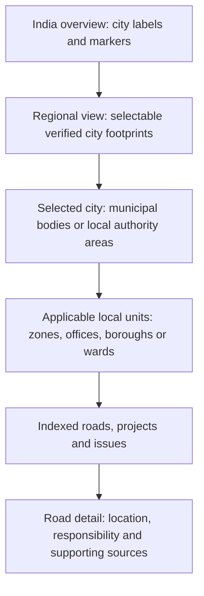
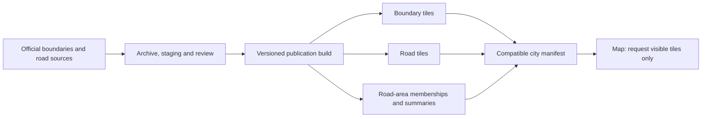

# City navigation report and Antigravity implementation brief

Prepared 16 October 2026 for The Road Problem.

## Purpose and instructions for Antigravity

Build a zoomed-out city selector on top of the road-tile and caching system already being implemented. Selecting a city should reveal its locally correct administrative divisions and then indexed roads, projects and issues.

This file combines the research report, the complete 36-city acquisition inventory and the implementation brief. It is a proposed design, not evidence that these features or datasets have been implemented. Source findings are dated; confirm the applicable final notifications, legal commencement, geometry and permissions before publishing a city layer.

### Required delivery order

- [ ] Inspect and reuse the current road-tile/cache implementation; document the shared city manifest and compatible release contract.
- [ ] Add the city catalogue, national/regional selection UI, deep links and honest availability states.
- [ ] Prove Bengaluru navigation against the existing Bengaluru Urban road-index footprint.
- [ ] Prove a complete official boundary adapter using Chennai's region/zone/ward service.
- [ ] Publish compatible road-area memberships and summaries, preserving historical references and preventing double counting.
- [ ] Prove metropolitan, multi-authority and sector-based navigation with Mumbai, Delhi and Noida.
- [ ] Onboard the remaining cities by verified data readiness, with unresolved layers explicitly pending.
- [ ] Provide the acceptance evidence, failure recovery and measured performance specified below.

Do not mark this work complete on the strength of a visual prototype or a list of source names. Deliver working source acquisition, validated published data, real-road examples, cache/recovery evidence and a clear list of remaining external blockers. Preserve the ongoing tile work and existing report/account flows.

The report, inventory and detailed implementation brief follow in that order. Supporting research links are optional background; the city inventory and core task requirements are included in this file.

---
## City selection and jurisdiction navigation: proposed design

Prepared 16 October 2026. This is a design and rollout plan for review; no application, database or deployment changes are included. Antigravity's road-tile and caching work remains the foundation for road rendering.

### 1. Intended result

When someone zooms out, the map becomes a way to choose a city. At national scale they see city names and selectable markers. Closer in, verified city footprints become selectable shaded areas. Selecting Bengaluru, Mumbai, Delhi or another city opens that area and reveals its own applicable administrative divisions. At street scale, indexed roads, projects and reported issues appear.

The city catalogue starts with **36 major city areas**, listed in [CITY_INVENTORY.md](CITY_INVENTORY.md). This is an explicit first research/onboarding scope, not a claim to enumerate every major Indian city or to have indexed those 36 cities. Additional cities use the same onboarding process and national identifiers.

Success means someone can find the right city, understand which local unit a road is in, and see who is responsible when there is supporting evidence. It also means the app clearly distinguishes missing data from zero spending, zero roads or zero issues.

### 2. Recommended approach and alternatives

| Approach | Benefit | Limitation | Decision |
|---|---|---|---|
| City markers and manually drawn approximate shapes | Quick discovery UI | Cannot support reliable ward attribution or agency accountability | Use markers while authoritative boundaries are pending; do not call approximate shapes official |
| One universal state → district → city → zone → ward tree | Simple initial implementation | Does not fit metropolitan areas, development authorities, multi-corporation cities or overlapping departments | Reject as the canonical model |
| City catalogue plus separate, versioned jurisdiction schemes | Fits local government differences and supports historical contracts | Requires a source registry, geometry review and explicit relationships | **Recommended** |

The displayed drilldown can look like a tree. The stored relationships must accommodate overlapping areas and different boundary schemes.

### 3. The geographic layers we need

| Layer | What it means | What it must not imply |
|---|---|---|
| City discovery region | A familiar place users can select; sometimes a collection of municipal bodies | A new government body or a road owner |
| Municipal body / development authority | The actual public organization and its notified jurisdiction | Ownership of every road inside it |
| Administrative area | Zone, circle, borough, regional office or other service unit | An electoral ward or engineering division unless specifically documented |
| Electoral area | Ward, division or prabhag under a particular delimitation | A maintenance jurisdiction; a prabhag can elect several councillors |
| Revenue geography | State, district, tehsil, village and other land-administration units | The same boundary as the city |
| Planning geography | Metropolitan region, master-plan zone, development node or sector | Municipal government or present road custody |
| Engineering / asset geography | Road division, work circle or maintenance package | A clean partition that necessarily follows wards |
| Indexed coverage | The actual footprint and source release used to import roads | The entire city or every real-world road |

Use separate schemes even where their names happen to match. An office without a published territorial polygon can still be represented as an organization with a documented service-area crosswalk; do not invent its polygon.

Examples supported by the research:

- Bengaluru needs GBA and its five corporations. The current road-import audit covers **Bengaluru Urban district**, which is a different footprint. Keep that coverage declaration intact. [GBA map entry point](https://gba.karnataka.gov.in/KnowYourNewCorporation/index.html); [existing coverage audit](../road-gap-repair/README.md).
- Hyderabad needs a city discovery entry spanning the three corporations confirmed by the Telangana government: GHMC, Cyberabad and Malkajgiri. Their current internal crosswalks need operative notifications. [Government source](https://hydraa.telangana.gov.in/about).
- Delhi opens the appropriate municipal jurisdictions, including MCD, NDMC and cantonment context. NCR is an optional metropolitan grouping containing separate selectors for Delhi, Gurugram, Faridabad, Noida, Greater Noida and Ghaziabad.
- Mumbai, Navi Mumbai and Thane remain separate city entries, optionally grouped under MMR. Pune and Pimpri-Chinchwad remain separate ULBs.
- Noida and Greater Noida use authority areas, sectors and villages, with engineering work circles separately. They must not receive invented municipal wards.

### 4. Map behaviour

These are navigation steps, not a universal government hierarchy. A city can skip a level or offer a choice of schemes.

#### Overview and selection

- At India scale, use labelled points or clusters. A city polygon may be only a few pixels across, so provide a minimum 44 CSS-pixel selection target and a keyboard-accessible city list.
- At regional scale, show a light fill and clear outline for verified city footprints. Select both by polygon and label. Use the actual MultiPolygon with documented exclusions; not a rectangular bounding box or convex hull.
- A label uses a reviewed point-on-surface or curated anchor, not a naive centroid that can fall in water or outside the territory.
- In dense areas such as NCR and MMR, clicking an overlapping cluster opens an explicit city list. Do not choose whichever polygon happens to be returned first.
- A metro grouping is labelled as a collection. Its totals deduplicate underlying roads and projects; it does not become another road-owning body.
- A city with no reviewed footprint can still have a catalogue marker labelled “Boundary pending”. Its marker opens an information panel; no invented official outline appears.

#### Within a city

- Clicking a ready city fits its bounds once, then loads its published manifest and visible geometry. Existing road/report deep links take precedence over automatic city fitting.
- Show a breadcrumb such as `India / Bengaluru / Bengaluru South / Ward …`, or `India / Noida / Sector …`. Labels come from configuration and official names.
- Offer a small layer selector for useful alternatives: municipal areas, wards, road-management units, or indexed coverage. Show one primary boundary scheme at a time to avoid overlapping visual noise.
- Clicking a local unit highlights it, scopes summaries to it, and offers “Show roads here”. Zooming farther can reveal the next applicable level without requiring a click at every stage.
- Crossing a city boundary by panning should not snap the map back. Retain selected context, show adjacent published coverage when appropriate, and offer an explicit switch to the neighbouring city.
- Zooming back out restores city discovery. Use different enter/exit thresholds and the projected size of the city to prevent flicker. Initial zoom bands can be tested around national 3–6, regional 6–9, city 9–12 and local 12+, but these are tuning values, not assumptions about every city's size.
- Honour reduced motion. City selection and road reporting must remain usable by keyboard and on mobile without hover.

#### Status and language

Navigation availability, indexed-road coverage, responsibility evidence and source ingestion each have their own status and timestamp. A city can have excellent ward polygons and no imported roads.

Public labels can say “Roads available in part of this area”, “Ward boundaries being updated”, or “Authority not established”. Unknown values display as unavailable, not zero. Neutral city fills indicate availability; issue-count colours must not imply road quality without reporting and coverage context.

Store official local-script names plus English names and aliases such as Bengaluru/Bangalore and Gurugram/Gurgaon. A search for `Ward 12` must show the city, body and boundary scheme before selection. Never assume that ward number is globally unique.

### 5. How we acquire authoritative information

#### National identity, local geometry

Use the **Local Government Directory (LGD)** to align official local-body identifiers, names and administrative changes where available. LGD provides unique codes; it does not establish that every city has a current downloadable polygon. [Ministry explanation](https://panchayat.gov.in/en/lgd/); [directory export entry point](https://lgdirectory.gov.in/demo/downloadDirectory.do).

Use each city's final government notifications and GIS data to establish boundaries. If a directory export requires a CAPTCHA or authorization, use a manual approved export or official access arrangement; do not design around bypassing it.

#### Source order

1. **Final operative notification and subsequent corrections:** identifies legal scope, names, codes, commencement and changes. A draft, reservation list or future amendment alone is insufficient boundary geometry.
2. **Official municipal/state GIS vector export:** GeoPackage, Shapefile, GeoJSON, KML, documented ArcGIS query service or WFS, reconciled with that notification.
3. **Official PDF maps and boundary schedules:** request the originating GIS files. Where permitted and necessary, digitise with georeferencing, independent review and a derived-data label.
4. **Secondary/open datasets:** useful for discovery or a clearly labelled temporary display after licence/date checks. They cannot silently become the official ward or ownership source.

A WMS image, public map viewer, planning map or static PDF does not automatically provide reusable vector polygons. Capture the reuse terms for each dataset. The MCD map examined explicitly restricts reproduction without permission, so Delhi must use reusable geometry or obtain permission before public tile publication. [MCD source map](https://mcdonline.nic.in/portal/downloadFile/mcd_map_full_zone_image_cd_23030712390030_230322122342342.pdf).

#### One repeatable onboarding pipeline

`Discover → archive originals → extract → reconcile legal version → normalize → validate → review → build releases → publish manifest`

For every source record, preserve publisher, direct URL, retrieval time, publication time, legal effective interval, notification number, checksum, licence/permission, original CRS, parser version and whether the result is official or derived. Keep originals separate from public map derivatives; never overwrite evidence when a PDF changes.

For ArcGIS sources, inspect schema and limits, fetch all object IDs, retrieve batches, and reconcile returned IDs/counts. A successful first page is not a complete city import. Chennai's official service is a practical reference adapter. [GCC boundary service](https://gisgcc.chennaicorporation.gov.in/server/rest/services/GCCPublic/GCC_AdminBoundary/MapServer).

Normalize geographic interchange to EPSG:4326, retain the original projection and use suitable projected/geodesic methods for measurement. Do not measure road length in degrees or use a display projection as a survey claim.

Validation checks include valid geometry; unique codes within the relevant release/body; expected final roster; correct CRS and bounds; MultiPolygons, islands and enclaves; unintended slivers, overlaps and gaps; documented water/cantonment/excluded areas; and a reviewed set of boundary-adjacent addresses. Dissolve zones from wards only when an explicit complete ward-to-zone mapping establishes that operation is valid.

Keep canonical reviewed geometry separate from generalized display tiles. Generalization may improve drawing speed, but a low-zoom outline or tile-clipped feature must never decide which ward contains a report pin or which road span belongs to an area. Those lookups use the pinned canonical boundary release.

Inspect semantic changes, not just counts: splits, merges, transferred areas, renamed bodies and reused ward numbers can preserve a total while changing meaning. Source conflicts block publication of the disputed layer, while an already verified city selector can remain available.

### 6. Mapping roads, tenders and responsibility correctly

#### Location membership

Keep canonical road and physical-segment IDs. A segment can cross several wards, districts or authority areas. Store many-to-many memberships with the exact boundary version, intersected span/geometry, measured length, fraction and method. Do not destructively split the canonical road simply because a ward boundary changes.

Calculate these relationships as a background publication step using indexed spatial operations, not a national intersection query on every map movement. Index-aware PostGIS predicates support this approach. [PostGIS spatial-index guidance](https://postgis.net/documentation/faq/spatial-indexes/).

For a report pin, use boundary-inclusive matching and preserve ambiguity at shared edges. `ST_Covers` includes boundary points, which can correctly return two neighbouring areas; that result needs an explicit ambiguity state rather than `LIMIT 1`. [PostGIS definition](https://www.postgis.net/docs/manual-3.5/en/ST_Covers.html). GPS uncertainty also needs to remain visible near a boundary or parallel roads.

A road running along a shared ward boundary can legitimately have its full span in both wards. Record shared/border membership explicitly; do not force every membership fraction to sum to one or choose an owner arbitrarily. Parent/city/metro road length must use the union of canonical spans, rather than adding overlapping child lengths.

#### Responsibility is a separate evidence record

Represent the following roles separately where supported: asset owner, maintenance custodian, procuring/employing authority, project delivery agency, contractor, utility road-cut permit authority and grievance-routing office. Each assignment identifies the road/asset and affected span, role, organization, supporting source, effective dates, evidentiary date, confidence and status: established, tentative, disputed, superseded or unknown.

Prefer road asset registers, maintenance inventories, handover orders and identifiable work orders. A tender establishes what its issuer procured; it does not automatically prove permanent ownership. A road inside a municipal ward may be maintained by a highway or another agency. A boundary reform alone must not transfer responsibility without the corresponding handover evidence.

#### Ingestion matching

Use source-specific jurisdiction metadata, official road/asset IDs, geography and dates to narrow candidates. Ward references are resolved under the scheme applicable to the document's period, with old/new crosswalks retained. Then compare road identifiers, geometry, chainage and place aliases. A city name is useful context, not a sufficient match.

Keep uncertain matches in review. If the source predates a reorganization, preserve its historical reference and derive a current display relationship separately. Official chainage and computed OSM geometry distance must not be treated as interchangeable without calibration.

#### Summaries and money

- Count distinct canonical entities, not tile fragments. Present road kilometres and the definition of road count; do not mix road names, OSM ways and physical segments.
- Keep sanctioned value, tender estimate, awarded value and verified expenditure separate. Do not call every contract value “spent”. Show date range, currency, source coverage and last refresh.
- A project spanning three wards is one project. Show a documented location allocation where available; otherwise label any length-based allocation as an estimate. Never add its entire budget to each ward and sum those totals.
- Authority and contractor counts use documented active relationships, with unknowns visible. Metro/city overlaps must not duplicate national totals.
- Report issue count per indexed road-kilometre or explicitly defined road count. Repair statistics show sample size, observation window and definition; unresolved/reopened cases must not become zero-day repairs. Aggregate observations rather than averaging already averaged ward values.

### 7. Proposed data model

This is a conceptual contract, not a migration request. Reuse compatible existing tables rather than duplicating them.

| Entity | Purpose |
|---|---|
| City catalogue | Stable internal ID, display names/aliases, discovery scope, label anchor, default bounds, metro memberships |
| Organization | Municipal body, authority or department; external LGD/official codes where applicable; predecessor/successor lineage |
| Jurisdiction scheme and unit | Explicit kind, local code, responsible publisher and relationships within that scheme |
| Boundary version | Unit geometry and source release, legal interval, source evidence, CRS, derivation and review status |
| Region-to-unit membership | Temporal relationship between a discovery region and one or several official units |
| Road-to-jurisdiction membership | Canonical segment and clipped span/length against a precise boundary release |
| Responsibility assignment | Road/asset/span, role, organization, effective interval, evidence and dispute/supersession state |
| Source registry and collection run | Adapter, coverage, cursor, failures, counts, last success and source version |
| Publication manifest | Compatible catalogue, boundary, road, membership, coverage and summary release references |

Use internal stable IDs plus scoped external identifiers. A code such as `12` is meaningful only with body, scheme and version. Keep legal validity time separate from when the app learned about a change so retroactive corrections and historical queries remain explainable.

Public map reads expose only published geographic and evidence data. Acquisition credentials, draft reviews and private source content stay server-side. Public government GIS sometimes includes property-account fields: fetch and publish only the approved boundary/road attributes needed for this feature.

Existing verified-email contributors may propose pin corrections or provide a better official source through the review flow. Such suggestions do not directly edit published government boundaries, transfer responsibility or rewrite source history. Preserve who proposed a change and the review evidence.

### 8. Integration with the new road-loading system

Reuse Antigravity's tile publication, rendering and caching path. This feature adds a small national discovery layer and a jurisdiction layer; it must not create a second road loader or return to full-city GeoJSON downloads.

- The national catalogue contains points, statuses, labels and lightweight bounds. Regional overview tiles contain generalized city footprints. Neither loads every city's road archive.
- Each published city references its own road layer and administrative-boundary layers. Static tiles are immutable and content/version-addressed; live issues and project changes use the existing separate update path.
- PMTiles uses range requests to read relevant portions of an archive; it does not require downloading the entire city file. Archives are read-only and rebuilt for updates. [Format documentation](https://docs.protomaps.com/pmtiles/).
- A **membership release must identify the exact road release and boundary release it was computed from**. Summary snapshots also identify compatible inputs. Independent version numbers without this dependency check are insufficient.
- Pin compatible releases for a browsing session. A changed manifest is validated and adopted together; do not combine new wards, old memberships and unrelated cached totals.
- Browser cache keys include city/tileset ID, release, layer and tile coordinates; PMTiles transport also identifies archive version/ranges. Use AG's cache abstraction, bounded storage/eviction and quota-error fallback. Previously viewed geometry should be reusable across zoom/pan; browser eviction is possible and is not an app failure.
- Keep small mutable manifests short-lived with ETags. Tile/manifest failures retain the last complete published release with an explicit age/status. Never cache an error as a successful empty city.
- Publish archives and verify accessibility first, then atomically update the manifest pointer. Retain old releases for rollback and active clients. Public cache settings must be verified: R2 custom-domain caching requires configuration. [Cloudflare guidance](https://developers.cloudflare.com/r2/buckets/public-buckets/).
- Offline or cached map viewing does not establish that live issue data is current. Show separate timestamps. Reporting and uploads retain their existing connectivity requirements.

### 9. Proposed interfaces

Names below are proposed contracts for AG to align with its existing implementation, not endpoints claimed to exist today.

| Interface | Returns / behaviour |
|---|---|
| `GET /api/v1/regions` | Small published catalogue: IDs, labels, scope, points/bounds and capability statuses; filter by region/viewport if catalogue grows |
| `GET /api/v1/regions/{id}/manifest` | Compatible release references, scheme choices, layer metadata, public URLs and attribution |
| Jurisdiction layer / unit lookup | Units scoped by region, scheme, body and effective date; tiled display plus canonical unit detail |
| Road responsibility lookup | Canonical road/segment/span assignments, roles, dates and source links |
| Region summary lookup | Precomputed named-area snapshot with release, date window, definitions and coverage; arbitrary viewport summary remains a separate bounded query |
| Search | City and jurisdiction aliases plus existing indexed road/project/source results; resolves IDs and explains scope |

At minimum a manifest needs `schema_version`, `region_id`, `publication_id`, discovery footprint release, jurisdiction release(s), road release(s), compatible membership release, coverage release, summary reference, effective/as-of date, bounds, supported layers and statuses. Shared road tilesets can be referenced by several adjacent city entries while canonical IDs prevent duplication.

### 10. Rollout plan

| Stage | Deliverable | Exit condition |
|---|---|---|
| 0. Align with AG | Shared region/manifest/version contract and responsibility boundaries for the work | Existing tile/cache implementation inspected; no duplicate loader or incompatible IDs |
| 1. Catalogue and overview | All 36 scoped city entries with sourced names, explicit footprints/statuses, labels, cluster/list selection and deep links | Overview requires no national road scans or unrelated city-road downloads; pending cities are honestly labelled |
| 2. Bengaluru pilot | GBA/corporation selector, current verified sublayers where obtainable, and crosswalk against existing Bengaluru Urban index coverage | Real road samples inside, outside and crossing the new units reconcile; historical BBMP references remain interpretable |
| 3. Chennai reference adapter | Official region/zone/ward ingestion through documented GIS queries | Full expected feature-ID set obtained, current legal version reconciled, permission checked, geometry and memberships reviewed |
| 4. Complex governance cases | Mumbai/MMR and Delhi/NCR navigation, Noida authority-based path | No metro/ULB confusion, no invented ward level, no unauthorised map republication, documented agency roles on sample roads |
| 5. Reorganizations and wider batches | Hyderabad, PCMC, Kolkata and Andhra transitions; remaining inventory cities by readiness | Final current notifications/corrections plus geometry/crosswalks; blockers remain visible per layer |
| 6. Operational updates | Monitored source refresh, semantic change review, publication/rollback dashboard | A staged boundary change can publish, revert and preserve historical projects without corrupting memberships or caches |

City navigation can ship before full ward or maintenance data is available. Conversely, complete boundaries do not justify marking road indexing or ingestion complete. Enable each capability only after its own checks pass.

Do not promise a date for nationwide authoritative ward coverage: department access, permission and current final geometry are external dependencies. Onboard in parallel by readiness rather than filling gaps with plausible-looking polygons.

### 11. Verification and operational gates

1. Every displayed official polygon has traceable source, legal/version context, reuse basis and reviewed geometry. Drafts and historical layers cannot become current through a newer scrape date.
2. Final roster IDs/counts reconcile with the acquired features. All service pages are fetched; no missing wards caused by API result limits.
3. Sample checks cover shared borders, islands, exclaves, roads crossing several wards, parallel carriageways, cantonments and areas outside indexed coverage.
4. Navigation handles single-ULB, multi-corporation, metropolitan grouping and development-authority cases. Mobile and keyboard users can select small/overlapping cities.
5. Unknown or disputed responsibility stays unknown/disputed. A city/ward inclusion never creates an ownership assignment.
6. Cross-boundary projects and roads are not duplicated in parent or metro summaries; expenditure definitions remain separate.
7. Network traces prove that overview loads no city-road data until needed, city selection loads only the chosen/visible layers, and revisits reuse cached geometry when still available.
8. Proposed initial performance budgets: city catalogue at most 100 KB compressed for this scope; city hover/selection feedback within 100 ms; useful cached city display within 1 second and cold display within 3 seconds on a defined mid-range mobile/4G profile. These are acceptance targets to measure, not current results or guarantees. Revise them only with recorded evidence.
9. New boundary, road and membership releases switch compatibly. Missing archive, offline mode, incompatible schema and stale browser manifest all have tested recovery; old published releases remain intact.
10. Source adapters demonstrate a real endpoint, representative records, preserved originals, duplicate-safe reruns and change history before being enabled routinely.

Track per-city last legal review, last source check/success, expected/imported unit counts, unresolved changes, permission blockers, membership build age and compatible publication ID. Track map request failures, cache hits, bytes transferred and latency by city/device. A suggested initial source-check policy is weekly for change notices and monthly for unchanged geometry, increased during a known delimitation; agree the operational schedule during implementation.

The main new effort is authoritative data acquisition and review, followed by membership/tile builds when a source changes. Routine browsing should primarily read cached objects and small summary snapshots. Measure storage, build time, object/range requests and database work per city before estimating operating cost; the plan makes no unmeasured promise of a free nationwide service. Reuse the existing agreed collection scheduler rather than introducing a competing refresh mechanism.

### 12. Handoff and supporting research

- [City-by-city inventory and acquisition routes](CITY_INVENTORY.md)
- [Focused handoff for Antigravity](AG_HANDOFF.md)
- [Southern city sources](research-south.md)
- [Western city sources](research-west.md)
- [North/east/central city sources](research-north-east.md)
- [Additional city sources](research-additional.md)
- [New Andhra notifications](research-andhra.md)

The next implementation decision is to agree this region/manifest contract with the existing tile work, then prove Bengaluru navigation and Chennai's boundary adapter before widening the published layers.

---

## Major-city jurisdiction inventory and acquisition plan

Research checked **16 October 2026**. Scope: **36 city discovery entries** for an initial major-city rollout. This is comprehensive within that selected scope; it is not a complete list of Indian cities or an assertion that these cities' roads are indexed.

Counts describe particular published schemes. **A verified roster count does not establish that current final polygon geometry has been obtained, checked or licensed.** City discovery, municipal administration, electoral wards, planning sectors and maintenance areas remain separate layers. The linked research notes contain supporting detail and additional official links.

### Southern cities

| # | City selector | Local structure the app must support | Official acquisition route | Remaining publication gate |
|---|---|---|---|---|
| 1 | Bengaluru | GBA → **five city corporations**: Central, North, South, East, West; corporation-specific zones/wards | [GBA corporation/ward finder](https://gba.karnataka.gov.in/KnowYourNewCorporation/index.html), [official map downloads](https://www.bbmp.gov.in/maps/); acquire final delimitation, corrections and source GIS | Reconcile current ward totals and all corporation/zone crosswalks; distinguish GBA extent from existing Bengaluru Urban district import |
| 2 | Hyderabad | **Three corporations**: GHMC, Cyberabad, Malkajgiri; current zones/circles/wards under each require operative annexures | [Official jurisdiction confirmation](https://hydraa.telangana.gov.in/about), [GHMC](https://www.ghmc.gov.in/ghmc.aspx); acquire constitution/delimitation orders and current TGRAC exports | Legacy 6/30/150 and newer single-GHMC descriptions coexist; no automatic reuse as the present three-corporation allocation |
| 3 | Chennai | **3 regions → 15 zones → 200 divisions/wards** | [Official council](https://chennaicorporation.gov.in/gcc/council/about-council/), [GCC ArcGIS](https://gisgcc.chennaicorporation.gov.in/server/rest/services/GCCPublic/GCC_AdminBoundary/MapServer): region layer 6, zone 5, ward 4, GeoJSON query capability | Fetch complete ID sets, reconcile final legal version and confirm reuse terms; strongest direct GIS reference adapter in this research |
| 4 | Coimbatore | **5 zones → 100 divisions**, 20 per zone; North, East, South, West, Central | [Official zone map](https://ccmc.gov.in/img/upload/Zone%20Map.pdf), [delimitation/gazette index](https://ccmc.gov.in/index.php/createpage/delimitation-of-ward); request vector export | Maps/PDFs found; no current complete vector export verified; department prose includes an older four-zone description |
| 5 | Kochi | **76 current electoral wards**; official office directory lists six zonal offices as a separate operational layer | [Current SEC ward roster](https://www.sec.kerala.gov.in/public/cnstncy/wd/d0f41644-754b-4b6e-a8dc-97ecbf5fee16), [municipal delimitation entry](https://kochicorporation.lsgkerala.gov.in/en/delimitation-commission-kerala-notification/590); acquire final Kerala/IKM/LSGD geometry | Reconcile 2024 map links with final 2025 changes; obtain current office-to-ward mapping rather than reuse old 74 wards |
| 6 | Thiruvananthapuram | **101 wards** in current SEC directory; municipal directory lists **11 zonal offices** | [Official SEC directory](https://www.sec.kerala.gov.in/public/ps/lb/da39a3ee5e6b4b0d3255bfef95601890af14/U/C), [zonal directory](https://tmc.lsgkerala.gov.in/en/corporation-zonal-offices); request final state/IKM GIS | Older organization page says six offices; final ward geometry and current office membership need reconciliation; some published delimitation files are drafts |

**Local naming detail:** Chennai zones are Thiruvotriyur, Manali, Madhavaram, Tondiarpet, Royapuram, Thiru-Vi-Ka Nagar, Ambattur, Anna Nagar, Teynampet, Kodambakkam, Valasaravakkam, Alandur, Adyar, Perungudi and Sholinganallur. Kochi's directory lists Vyttila, Edapally, Fort Kochi, Mattanchery, Palluruthy and Pachalam; these office names do not by themselves establish polygon boundaries. See [southern research](research-south.md).

### Western cities and Jaipur

| # | City selector | Local structure the app must support | Official acquisition route | Remaining publication gate |
|---|---|---|---|---|
| 7 | Mumbai | BMC municipal footprint → **24 administrative wards**; electoral prabhags separate; engineering areas can differ | [BMC ward map](https://portal.mcgm.gov.in/irj/portal/anonymous/BMC-on-Map-Wards-Offices?guest_user=english), [ArcGIS service](https://prsrvgisapp.mcgm.gov.in/server/rest/services/mcgm/MCGMGIS_Departments_Master_All_Layers_WGS/MapServer) | Polygon/query metadata found; complete current export and reuse not verified. Obtain any higher administrative grouping separately. Mumbai is not the whole MMR |
| 8 | Pune | PMC → current administrative ward offices and separately electoral prabhags; **15 offices is a historical official baseline**, not a certified current total | [PMC](https://www.pmc.gov.in/), [official open data](https://opendata.pmc.gov.in/); obtain current municipal limits, office orders/GIS and final election maps | Current exact administrative count and enlarged-city geometry remain unresolved; do not substitute electoral ward counts |
| 9 | Pimpri-Chinchwad | **10 regional offices**, A/B/C/D/E/F/G/H/J/L, with a **32-prabhag** crosswalk | [Current office directory](https://www.pcmcindia.gov.in/ward_info), [election portal](https://www.pcmcindia.gov.in/electionNew), [official GIS](https://smartgisda.pcmcindia.gov.in/CitizenPortal/) | Old eight-office descriptions are stale. GIS returned an error during research; request current vectors and dated notification |
| 10 | Ahmedabad | **7 administrative zones**; official profile/tender baseline **48 wards**, conflicting official page says 64 | [AMC profile](https://ahmedabadcity.gov.in/Home/AboutTheCorporation), [conflicting official page](https://communityservice.ahmedabadcity.gov.in/about-us); obtain current AMC GIS and final Gujarat delimitation | Resolve the ward conflict before certifying current polygons; no official current full vector download verified |
| 11 | Surat | **9 administrative zones**; separate administrative-office units and electoral wards; official electoral page has **30 wards/120 seats** with a 2022 timestamp | [SMC](https://www.suratmunicipal.gov.in/), [elected wing](https://www.suratmunicipal.gov.in/Corporation/ElectedWings), [GIS](https://gis.suratmunicipal.org/) | GIS requires login; older zone PDFs need reconciliation with present city expansion/zone splits; current electoral release needed |
| 12 | Jaipur | Official current city profile: **13 geographical zones / 150 wards**; planning zones are separate | [City profile](https://jaipurmc.org/Presentation/AboutMcjaipur/CityProfile.aspx), [current tenders](https://www.jaipurmc.org/presentation/Others/JTender.aspx); request final reorganization, crosswalk and GIS | Current tenders explicitly use old/new ward IDs. Reconcile old Greater/Heritage structures and new numbering; no current complete vector export verified |
| 13 | Nagpur | **10 administrative zones**; final 2025 election index covers **38 prabhags** | [Official election index](https://election.nagpurnmc.in/nmc_yearwise_news/1), [final consolidated map](https://election.nagpurnmc.in/storage/uploads/1759757438_QGIS%20FINAL%20MAP%202025New-1-39-39.pdf) | Final PDF accessible; vector export pending. A district page's 145-ward statement is not the current electoral geometry |
| 14 | Nashik | **6 administrative divisions**; current 2025–26 final election index lists **31 prabhags** | [Office/engineering directory](https://nmc.gov.in/home/getfrontpage/7/191/M), [final map/gazette index](https://nmc.gov.in/home/getfrontpage/244/204/M) | Obtain division GIS separately from electoral maps; reject searchable legacy draft maps as current |
| 15 | Navi Mumbai | Scope initially **NMMC municipal area**; official DP baseline **2 zones / 8 ward offices**; CIDCO nodes/sectors separate | [Official DP report](https://online.nmmc.gov.in/navimumbai/assets/251/2024/03/mediafiles/FINAL_DP_REPORT_.pdf), [office page](https://nmmc.gov.in/ward-offices), [CIDCO plans](https://cidco.maharashtra.gov.in/Page?Token=831AAA8551) | Confirm current release and obtain vectors; NMMC is not the entire planned Navi Mumbai area. Panvel requires its own ULB entry |
| 16 | Thane | TMC municipal area → administrative committees/offices and separately electoral prabhags. **Nine committees is historical audit evidence only** | [TMC](https://www.thanecity.gov.in/), [official historical CAG audit](https://cag.gov.in/uploads/download_audit_report/2021/8%20CHAPTER%20IV-0630766294ff3c1.19960863.pdf); request current orders/GIS/election maps | Current primary boundary inventory inaccessible in this research; certify neither nine committees nor disputed electoral totals as a present release |

**Local naming detail:** PCMC offices are Rajgad, Sinhgad, Vijaydurg, Devgiri, Shivneri, Torna, Purandar, Pratapgad, Raigad and Lohgad. Ahmedabad zones: Central, East, West, North, South, North West, South West. Surat: West, Central, North, East A, East B, South A, South B, South West, South East. Nagpur: Laxminagar, Dharampeth, Hanuman Nagar, Dhantoli, Nehru Nagar, Gandhibagh, Satranjipura, Lakadganj, Ashi Nagar, Mangalwari. Nashik: Nashik East, Nashik West, Nashik Road, Panchavati, Satpur, New Nashik/CIDCO. Full acquisition caveats are in [western research](research-west.md).

### Northern, eastern and central cities

| # | City selector | Local structure the app must support | Official acquisition route | Remaining publication gate |
|---|---|---|---|---|
| 17 | Delhi | Municipal jurisdictions first: MCD, NDMC and cantonment context. Published MCD scheme: **12 zones / 250 wards** | [MCD zone/ward/colony crosswalk](https://mcdonline.nic.in/ptrmcdbeta/web/citizen/property/downloadPdfFile/New_colony_ward_zone_mapping), [MCD GIS](https://info.mcd.gov.in/), [NDMC roads divisions](https://ndmc.gov.in/departments/civil_i.aspx) | Examined MCD PDF restricts reproduction. Obtain reusable official vectors/permission, current boundaries and road custody; NCR is a separate grouping |
| 18 | Gurugram | MCG current official map: **36 wards**; clusters/zones require **17 September 2026** order | [MCG ward map](https://www.mcg.gov.in/map), [latest zone notices](https://www.mcg.gov.in/Zones.aspx), [GMDA boundary service](https://onemapdepts.gmda.gov.in/server/rest/services/onemap/Boundary_GMDA/MapServer) | June 2026 eight-zone map must not be assumed current after September order. GMDA/MCG/Manesar/private-colony territories are different |
| 19 | Noida | NOIDA authority footprint → sectors/villages for discovery; engineering work circles separately | [Official district authority directory](https://gbnagar.nic.in/public-utility-category/authority/), [NIC OneMap](https://umd.nic.in/noida/Map.aspx?UNIQUEPLOTID=4B002IND); request notified extent, sector GIS and current work-circle order | No current complete work-circle count/geometry verified; no invented municipal ward model. Exclude private property-account fields |
| 20 | Greater Noida | GNIDA authority footprint → sectors/villages; engineering work circles and project divisions separately | [Official authority directory](https://gbnagar.nic.in/public-utility-category/authority/), [NIC OneMap manual](https://umd.nic.in/gnida/userManual/Help%20Manual%20Khasra%20Edit%20Module.pdf); obtain public sector/boundary exports and engineering orders | Separate Noida, YEIDA and New Noida/DNGIR; authorized land modules are not public data feeds; exact current work-circle set pending |
| 21 | Ghaziabad | **5 zones → 100 wards**; City, Kavi Nagar, Vijay Nagar, Mohan Nagar, Vasundhara | [Municipal overview](https://ghaziabadnagarnigam.in/Default.aspx), [zone/ward/mohalla crosswalk](https://ghaziabadnagarnigam.in/zones-and-wards.aspx), [GDA GIS](https://gis.gdaghaziabad.in/) | Crosswalk repeats some ward numbers across service areas: reconcile rather than assume a partition. GDA planning footprint is separate; vectors pending |
| 22 | Faridabad | MCF **46 wards** under final 11 January 2024 notification. FMDA separately provides **3 zones / 6 subzones / sectors** | [Final municipal gazette](https://ulbharyana.gov.in/AdminDashboard/ViewUploadFile?fileName=%5CCONTENTFILES+%2F%2Fb96e6474-bde2-4ae1-bdc0-071954236882.pdf), [FMDA GIS service](https://onemapdepts.gmda.gov.in/server/rest/services/FMDA/FMDA_Zone_and_Sub_Zone_Boundary_of_Faridabad/MapServer) | FMDA zones are not established as municipal zones. Match current GIS to each scheme's notification; verify any subsequent change |
| 23 | Kolkata | UDMA lists an **11 September 2026 Schedule II amendment for 144 → 209 wards**. Published **16-borough/144-ward** crosswalk remains a legacy/reference scheme pending commencement review | [Official UDMA notices](https://udma.wb.gov.in/index.php), [legacy KMC crosswalk](https://www.kmcgov.in/KMCPortal/outside_jsp/KMC_New_Borough_07_07_2015.jsp), [KMC maps](https://www.kmcgov.in/KMCPortal/jsp/UAAMapView.html) | Obtain actual amendment/annexure, operative date, matching geometry and borough mapping before certifying the current operational scheme; announcement title alone does not establish commencement. Keep neighbouring ULBs separate |
| 24 | Lucknow | Official engineering interface lists **8 zones**; existing official ward records extend to **110** | [Current engineering-zone interface](https://lmc.up.nic.in/NalaEng.aspx); request final current ward/zone notification and GIS | Old six-zone plan and explicitly draft 2017 ward PDF cannot establish the current map. Final current roster/crosswalk must be confirmed |
| 25 | Kanpur | Official **2017** table: **6 zones / 110 wards** | [Municipal zone/ward table](https://kmc.up.nic.in/PDF_Files/others/zonewardlist.pdf); request current GIS and final later notifications, if any | Historical baseline requires freshness review. Municipal extent, cantonment, KDA and revenue district remain separate |
| 26 | Indore | Current councillor page lists **85 wards**; zone count unresolved: official legacy **19** versus later **22** reports | [IMC councillors](https://imcindore.mp.gov.in/councillors), [official Smart City overview](https://www.smartcityindore.org/solid-waste/); acquire current zonal order/GIS | Do not certify either zone count without current order. Road assets, IDA scheme handovers and wards are separate |
| 27 | Bhopal | Published district page **85 wards / 19 zones** conflicts with later **21-zone** references | [Official demography](https://bhopal.nic.in/en/demography/); obtain current BMC zone order, final ward schedule and GIS | Current zone count/geometry unresolved; planning land-use zones cannot substitute. Former municipal web domain was not a working current feed |
| 28 | Chandigarh | **35 electoral wards** under 2020 delimitation/2021 official report; sectors are a separate resident navigation layer | [Official election report](https://chandigarh.gov.in/sites/default/files/GEMCC-2021/Election-Report-2021.pdf), [Engineering Department](https://chandigarhdistrict.nic.in/engineering/); acquire latest MC/Administration GIS and sector maps | Verify no superseding scheme and current road-transfer records. Mohali/Panchkula belong to a separately labelled Tricity grouping |

**Local naming detail:** MCD's published zones are Central, City SP, Civil Lines, Karol Bagh, Keshav Puram, Najafgarh, Narela, Rohini, Shahdara North, Shahdara South, South and West. Named zones in a map legend do not prove which department maintains each road. See [north/east/central research](research-north-east.md).

### Additional major city areas

| # | City selector | Local structure the app must support | Official acquisition route | Remaining publication gate |
|---|---|---|---|---|
| 29 | Patna | **6 municipal circles / 75 wards** in official sources; municipal circles differ from revenue circles and planning zones | [PMC circle confirmation](https://www.pmc.bihar.gov.in/ptaxAssessment.aspx), [ward roster/areas](https://www.pmc.bihar.gov.in/wardwisearea.aspx), [municipal GIS entry points](https://www.pmc.bihar.gov.in/ITinitiative.aspx) | Obtain current circle membership and reusable boundary export; older budget crosswalk duplicates ward 55, so cannot seed it without reconciliation |
| 30 | Bhubaneswar | Official site/final 2022 notification: **67 wards**, with three published territorial groupings. **Current zone organization requires a new order check** | [BMC zones/wards and map index](https://www.bmc.gov.in/about/zones-wards), [final ward notification](https://cms.bhubaneswarone.in/uploadDocuments/content/1556-BMC_Final_Notification.pdf), [ward map](https://cms.bhubaneswarone.in/uploadDocuments/content/Ward_Map_1.pdf) | Reports of a 2026 six-zone reorganization need operative official confirmation; do not publish old three-zone shapes as current on website text alone |
| 31 | Visakhapatnam | Official 13 October 2026 APSEC document confirms **120 wards**. Official September 2025 memo approved **10 zones**, with an older 98-ward crosswalk | [Current APSEC document](https://sec.ap.gov.in/Uploads/Doc26/Res/MC_Greater%20Visakhpatnam.pdf), [zone memo](https://www.gvmc.gov.in/wss/image_uploads/city%20town%20planning.pdf), [GVMC source index](https://gvmc.gov.in/thirdlevel.htm?OtpCode=2026&levelid=200-111) | Need final current polygon geometry and 120-ward-to-zone crosswalk. Linked preliminary notification/proposed map must not be treated as final |
| 32 | Vijayawada | Official APSEC document dated **13 October 2026** confirms **86 wards**; earlier official city reports describe three administrative circles | [APSEC/NTR Gazette 97](https://sec.ap.gov.in/Uploads/Doc26/Res/MC_Vijayawada.pdf), [VMC](https://vmc.ap.gov.in/); acquire final delimitation/GIS plus current circle assignment | New roster supersedes the old 64-ward assumption for that release. Reservation publication does not supply final boundary coordinates or prove the current circle crosswalk |
| 33 | Guwahati | **6 zones / 60 wards**; published zones serve trade licensing, property tax and assessment | [Official zones with old/new ward crosswalk](https://gmc.assam.gov.in/about-us/detail/our-zones), [final 60-ward map index](https://gmc.assam.gov.in/latest/final-delimitation-of-60-wards-map-of-guwahati-municipal-corporation) | Obtain final release dates and reusable vectors; these revenue/service zones are not automatic road engineering divisions |
| 34 | Ranchi | Official 2025 election publication lists **wards 1–53**; do not manufacture an intermediate zone level | [District election publication](https://ranchi.nic.in/notice/ranchi-nagar-nigam-election-2025/), [RMC fact sheet](https://www.ranchimunicipal.com/AboutUs.aspx?uid=2) | Current polygon export and engineering-office structure pending; fact sheet includes old demographic/asset figures, so not every number is current |
| 35 | Raipur | Current municipal directory lists **10 zones**, each with commissioner/engineer; published ward roster has **70 actual wards** | [Official zonal directory](https://nagarnigamraipur.nic.in/en/contact-us), [ward list](https://nagarnigamraipur.nic.in/en/node/3055/wardmaptrack.php?ward_no=15), [ward boundary entry](https://nagarnigamraipur.nic.in/hi/ward-boundaries) | Old whole-city PDF says eight zones; request latest ten-zone/ward geometry and order. Reject operational “Zone extra” rows as real wards. Atal Nagar/Naya Raipur is separate |
| 36 | Madurai | **5 zones / 100 wards** in current council roster: East, North, Central, South, West | [Official council roster](https://maduraicorporation.co.in/aboutus/council/), [municipal map entry](https://maduraicorporation.co.in/aboutus/general-infozones-and-wards/); request current municipal GIS | Current complete vector export not verified. Water-distribution zones and older four-zone/72-ward reports are different or historical datasets |

**Local naming detail:** Patna's six civic circles are Patliputra, New Capital, Kankarbagh, Bankipore, Azimabad and Patna City; obtain current assignments rather than reuse the old budget table. Guwahati's service zones are Central, East, South, West, Dispur and Lokhra. Madurai labels its zones East I, North II, Central III, South IV and West V. See [additional research](research-additional.md) and [Andhra source verification](research-andhra.md).

### Which road-management records to collect

These are **candidate organizations and source families for investigation**, not ownership assignments for all roads in a city. Enable a responsibility claim only after a road/asset/span-level record supports the stated role and time period. An organization may be a funder or project builder while another maintains the finished road.

| City areas | Municipal/authority records to start with | Parallel records to reconcile |
|---|---|---|
| Bengaluru | GBA/city-corporation road inventory, Road History, work orders and handover records | Karnataka PWD, highway agencies, BDA and other asset-owning bodies where the corridor record supports them |
| Hyderabad | Each of the three corporations' engineering and maintenance records | HMDA/HGCL projects, state Roads & Buildings, highway and relevant utility road-cut records |
| Chennai, Coimbatore, Madurai | Municipal engineering/road registers, zone-level works; Chennai Bus Route Roads versus interior roads | Tamil Nadu Highways and national-highway corridors; project/utility restoration agreements |
| Kochi, Thiruvananthapuram | Municipal engineering and office work orders | Kerala PWD, highway agencies, GCDA/CSML in Kochi and KRFB/TCRIP in Thiruvananthapuram, with dated handovers |
| Mumbai, Navi Mumbai, Thane | BMC/NMMC/TMC asset and maintenance records, separately | MMRDA, MSRDC, CIDCO, state PWD, highway, port/MIDC and special-estate records where applicable |
| Pune, Pimpri-Chinchwad | PMC and PCMC as separate asset custodians | PMRDA, state PWD, highway, MIDC and current cantonment/civic transfer records |
| Ahmedabad, Surat | AMC/SMC roads, bridges, zone engineering and maintenance contracts | AUDA/SUDA projects, state R&B and highway records; distinguish scheme construction from current maintenance |
| Jaipur, Nagpur, Nashik | JMC/NMC municipal engineering, regional/divisional assets and current tenders | JDA/NIT and other development projects, state PWD, highway and handover records |
| Delhi | MCD, NDMC and relevant cantonment assets separately | Delhi PWD inventory/divisions, DDA, highway and other corridor-specific custodians |
| Gurugram, Faridabad | MCG/MCF assets and maintenance records separately | GMDA/FMDA roads and handovers, HSVP, Haryana PWD, highway records and colony transfers |
| Noida, Greater Noida | NOIDA/GNIDA engineering work circles, asset registers and maintenance tenders | State/highway corridors, utility permissions, private-to-public handovers; YEIDA is a separate authority |
| Ghaziabad, Lucknow, Kanpur | Respective Nagar Nigam engineering/road assets | GDA/LDA/KDA schemes, UP PWD, highway and current cantonment-transfer records |
| Kolkata | KMC Roads Department and borough engineering records with the correct historical/current scheme | KMDA, state PWD, highway and other specific asset-owner inventories; neighbouring ULBs separately |
| Indore, Bhopal | IMC/BMC current road inventories and zonal maintenance contracts | IDA/BDA scheme handovers, MP PWD and highway records |
| Chandigarh | Chandigarh MC road divisions and Administration Engineering assets | Dated service/road transfers between Administration and MC; planning sectors separately |
| Patna | PMC circle engineering/assets and maintenance works | Bihar Road Construction Department, BUIDCO/other project records, highway assets and handovers |
| Bhubaneswar | BMC road works and asset registers | Odisha Works Department, BDA projects, highway and handover records |
| Visakhapatnam, Vijayawada | GVMC/VMC engineering and works under the relevant ward release | Andhra R&B, VMRDA/APCRDA projects as applicable, highway records and custody transfers |
| Guwahati | GMC road/engineering and restoration records | Assam PWD, GMDA projects, highway assets and handovers |
| Ranchi | RMC engineering and work records | Jharkhand Road Construction Department, JUIDCO projects, highway assets and handovers |
| Raipur | Municipal zone engineers' assets and works | Chhattisgarh PWD, Raipur Development Authority and highway assets; distinguish NRANVP/Atal Nagar |

Primary agency evidence and examples are linked in the regional research notes. Where a city currently lacks a working public asset feed, the next acquisition action is a department data request or approved export, not a fabricated adapter. Each adapter must later demonstrate its actual endpoint and sample records.

### What each city onboarding package must contain

1. Catalogue ID, official and common names, local-language aliases, selected footprint definition, metro group memberships and official-body IDs.
2. Final legal source and corrections for the footprint and each chosen local layer, with publication and commencement dates kept separate.
3. Original files/services, licence/permission, archive checksums, CRS and complete source-ID roster.
4. Canonical municipal/ward geometry plus any separate administrative, engineering or planning layers and their crosswalks. Unknown layers remain absent.
5. Coverage declaration for road indexing, date/source release and measured reconciliation; never infer this from available city geometry.
6. Candidate authority/source registry, documented responsibility samples, unresolved disputes and evidence limits.
7. Reviewed geometry QA, road-area memberships, compatible publication manifest and per-capability readiness/freshness.

Do not manually encode every ward into UI source code. Acquire and validate the full official ward roster as data. The source inventory links those rosters or the responsible acquisition route; thousands of ward names are intentionally not copied into this planning document.

### Expansion after this inventory

Use LGD and a declared product coverage policy to extend the catalogue; do not depend on maintaining a permanent handwritten list. Potential later entries include Vadodara, Rajkot, Agra, Varanasi, Prayagraj, Meerut, Ludhiana, Amritsar, Jodhpur, Jabalpur, Gwalior, Srinagar, Jammu, Howrah, Bidhannagar/New Town, Panvel, Mohali and Panchkula. These are candidate additions, **not researched or approved boundary releases in this inventory**. Prioritize user demand, road-source availability and boundary readiness, rather than promising all-city parity at launch.

---

## Antigravity handoff: city selection and jurisdiction layers

Prepared 16 October 2026. This is the next feature design for review, after the road-tile/cache work already in progress. It does not instruct a second implementation of that loader.

Read [the design](README.md) and [the 36-city source inventory](CITY_INVENTORY.md) before implementation. Use the inventory as a research baseline, not as a ready-to-import current polygon collection.

### Intended user experience

At national zoom, show a lightweight set of labelled city markers/clusters. At regional zoom, verified city footprints become selectable zones. Clicking a city opens its appropriate municipal bodies and local divisions; street zoom reveals indexed roads, projects and issues. Zooming back out returns to city selection.

The first release should support the catalogue and honest availability states for the scoped cities, while publishing detailed geometry only for cities whose data has passed the gates. It must be possible to browse a city marker whose road index or current ward boundaries are still pending.

### Decisions to preserve

1. **A city selector is a discovery region.** It can collect several official bodies, but must declare its scope. A metro grouping is not a new road owner. Mumbai/Navi Mumbai/Thane and Delhi/NCR cities remain distinct entries.
2. **No fixed national district/city/zone/ward hierarchy.** Configure local navigation from typed schemes and relationships. Revenue districts, electoral wards, service offices, planning zones and engineering divisions are distinct.
3. **Current reorganizations matter.** Bengaluru needs five corporations; Hyderabad has three. Kolkata's official 2026 amendment, PCMC's ten offices and Andhra's October 2026 ward rosters require current legal/geometry reconciliation. Do not seed older easy-to-find counts as current.
4. **Location does not prove maintenance responsibility.** Store geographic membership separately from documented owner, maintainer, work-employer, delivery agency, contractor and utility roles, with source, road span and effective dates.
5. **Preserve existing IDs and coverage claims.** The current Bengaluru Urban district road footprint is not identical to GBA. A new ward split must not rewrite canonical road IDs or turn an old source's BBMP reference into a modern corporation without a crosswalk.
6. **Keep all data states honest.** Boundary available, roads indexed, responsibility documented and sources refreshing are independent capabilities. Unknown totals are unavailable, not zero.

### Integration contract to agree first

Map the following concepts onto the tile system you are building; reuse existing names where equivalent. Avoid parallel manifests or loaders.

| Manifest concept | Required meaning |
|---|---|
| `schema_version` | Client compatibility; unsupported versions have an explicit fallback |
| `region_id` | Stable discovery-region identity, independent of display name or ward number |
| `publication_id` | One immutable compatible publication bundle |
| Discovery footprint reference | Reviewed city scope, geometry version, label anchor, bounds and provenance |
| Jurisdiction release references | Named typed schemes and legal dates; may reference several municipal bodies |
| Road release references | Existing published road tilesets, canonical feature IDs and coverage metadata |
| Membership release reference | Computed from the **exact road and boundary inputs**; cannot be silently reused after either changes |
| Summary reference | Snapshot/date window and compatible inputs; definitions and source coverage |
| Capability statuses | Separate navigation, road coverage, responsibility and ingestion readiness/freshness |
| Public layer metadata | URLs, zoom bands, source-layer names, attribution, reuse basis and display names |

Keep IDs stable across tile boundaries; distinguish whole roads, physical segments and tile fragments. Shared tilesets can serve neighbouring regions; deduplicate by canonical identity. A region may reference several coverage releases where needed.

The national overview loads no city-road archives. On city selection, retrieve its small manifest, then request only visible relevant road/boundary tiles through the existing cache path. Use independent immutable boundary archives and versioned publication keys. Pin compatible references for the session, switch them together, and retain previous releases for active clients and rollback.

A PMTiles range reader must not become an accidental full-archive prefetch. Preserve correct range/CORS/cache handling from the tile work. Cache errors must not become successful empty regions. Browser storage quota or eviction failures fall back to network/session memory without breaking navigation.

### Data onboarding before publication

- Align body IDs/names with LGD where available; keep schemes and scoped local codes separate.
- Archive final notification, corrections, source geometry, timestamps, CRS, checksum, terms and parser version. Record legal commencement separately from upload date.
- Acquire official vector data through supported downloads/queries, obtaining all pages/object IDs. Request department exports where there is only a viewer, login or PDF.
- For PDF-derived geometry, require permission, georeferencing, review and a visible derived-data status. The examined MCD PDF has a reproduction restriction; do not assume permission to publish its traced boundaries.
- Stage and review semantic changes, topology, expected IDs/counts and sample locations before publishing. A matching total alone does not prove the units are correct.
- Compute road-to-area span memberships from canonical geometry. Preserve boundary ambiguity. Never infer custody solely from spatial inclusion.
- Use generalized tiles for display only; pin/road attribution uses the matching canonical boundary release. For roads along shared borders, preserve shared memberships and union canonical spans for parent totals rather than adding child lengths.
- Publish immutable files first, verify them, then atomically update the manifest. A failed ingestion/build keeps the previous complete publication.

### Suggested work sequence

1. Inspect the current tile/cache result, existing map/report/search flows and database model. Produce the mapping from this contract to that implementation before adding new interfaces.
2. Add catalogue storage/read interface and overview rendering. Support points, clusters, verified polygons, pending states, accessible list and region deep links. Reuse the existing theme; this feature does not require a globe filter or application-wide redesign.
3. Prove Bengaluru selection and multiple corporations against the existing district-index footprint. Publish verified layers only; unfinished ward/corporation data stays explicitly pending.
4. Build Chennai's official boundary adapter as a reusable reference: 3 regions, 15 zones, 200 wards, complete GIS pagination and final legal reconciliation.
5. Add road-area membership publication and named-area summaries. Test historical references, crossings, overlaps and money deduplication.
6. Prove multi-authority/metro behaviour with Mumbai and Delhi, and a sector-based path with Noida. Respect data access/reuse blockers.
7. Onboard remaining cities by source readiness. Reconcile the current Hyderabad, PCMC, Kolkata and Andhra transitions before activating their detailed sublayers.
8. Add source-change review, recovery, performance measurements and a per-city operational dashboard using the agreed existing scheduler/collection infrastructure.

### Acceptance evidence to provide

- Demonstrate India overview → city → applicable local unit → real road → back to overview on desktop and mobile, including keyboard selection and dense NCR/MMR city clusters.
- Preserve report drafts and direct road links; city selection must not unexpectedly relocate an existing report pin.
- Show network traces proving no national road download at overview, no unrelated city downloads on selection, and cache reuse after pan/zoom/revisit.
- Reconcile complete official source IDs, legal version and geometry for each published layer; show why pending cities/layers remain pending.
- Verify a road crossing several wards, a border pin returning ambiguity, a highway within a municipal ward, and a contract referring to a superseded ward number.
- Demonstrate no duplicated projects/budgets in ward/city/metro totals; distinguish actual expenditure from estimates/awards and show coverage/date ranges.
- Simulate an unavailable tile archive, stale manifest, incompatible schema, browser cache eviction and failed update. Keep a coherent old release or show a recoverable availability state.
- Provide measured performance against the agreed device/network profile. Proposed targets and detailed release gates are in the design; do not report them as achieved without measurement.

Do not enable a new source adapter on a list of plausible source names alone. Show a working endpoint or approved export, representative records, preserved originals, duplicate-safe reruns and change history.
